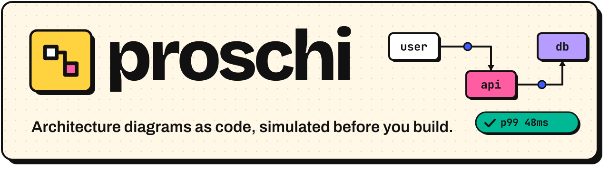
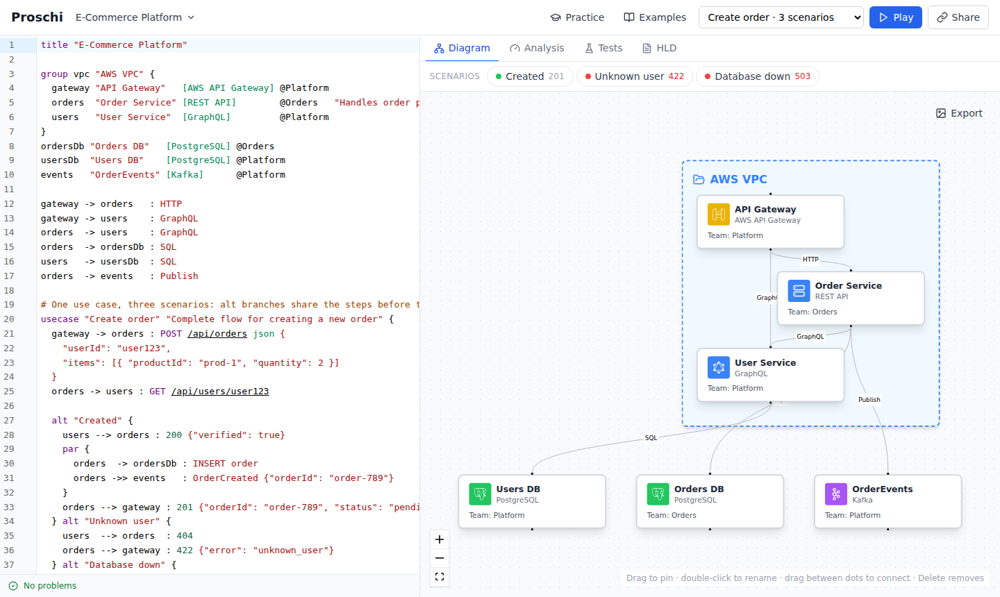

<p align="center">
  <a href="https://proschi.app/">
    <picture>
      <source media="(prefers-color-scheme: dark)" srcset="docs/images/banner-dark.svg">
      
    </picture>
  </a>
</p>

<p align="center">
  <a href="https://proschi.app/"></a>
  <a href="https://www.npmjs.com/package/proschi"></a>
  <a href="https://open-vsx.org/extension/gvart/proschi"></a>
  <a href="https://plugins.jetbrains.com/plugin/34955-proschi"></a>
  <a href="LICENSE"></a>
</p>

<p align="center">
  <a href="https://proschi.app/app/"><b>Try it</b></a> ·
  <a href="https://proschi.app/docs/"><b>Docs</b></a> ·
  <a href="https://proschi.app/practice/"><b>Practice</b></a> ·
  <a href="docs/EDITORS.md"><b>Editors and CLI</b></a> ·
  <a href="CHANGELOG.md"><b>Changelog</b></a>
</p>

Proschi is a small text language for architecture diagrams. You write the
nodes, connections and request flows of a system as plain text; Proschi lays
out the diagram, plays every use case step by step, and runs a deterministic
simulation of load, latency, availability and cost against the requirements
and tests you write next to it. The same parser runs in the browser, the CLI,
the language server and the editor plugins, so they always agree.

```proschi
user "User"      [Actor]
api  "Notes API" [REST API]   @backend
db   "Notes DB"  [PostgreSQL] @backend

user -> api : HTTPS
api  -> db  : SQL

usecase "Create a note" {
  user -> api  : POST /notes
  api  -> db   : INSERT note
  db  --> api  : 1 row
  api --> user : 201 {"id": 42}
}

traffic {
  "Create a note" 200 rps
}

requirements {
  p99 "Create a note" < 200ms
}
```



## What's in the box

- **[Editor](https://proschi.app/app/)**: completion, live diagnostics,
  automatic layout, use case playback, share links and PNG/SVG/Mermaid
  export. Runs in the browser; nothing is uploaded.
- **Simulation and HLD**: traffic, replicas, shards, capacity and decisions
  turn a diagram into a design document with load, p99, availability and
  cost per node. [How the simulation works](https://proschi.app/docs/model/).
- **[Practice](https://proschi.app/practice/)**: system design problems (URL
  shortener, payments, chat, video streaming and more) whose tests tell you
  whether your design holds up, plus review cards and the Scale or Fail game.
- **Tooling**: the [`proschi`](https://www.npmjs.com/package/proschi) CLI
  (`check`, `fmt`, `render`, `test`, `analyze`), a language server, the
  [VS Code extension](https://open-vsx.org/extension/gvart/proschi), the
  [JetBrains plugin](https://plugins.jetbrains.com/plugin/34955-proschi), a
  [GitHub Action](docs/EDITORS.md#github-action) that comments each pull
  request's diagrams, tests, cost and p99, and
  [agent skills](docs/AGENT-SKILLS.md) for Claude Code, Codex, Cursor and
  others, with a Claude Code plugin that also
  [draws diagrams in the terminal](docs/AGENT-SKILLS.md#diagrams-in-the-terminal).

The [language reference](docs/LANGUAGE.md) covers the syntax in full.

## Use it

```sh
npx proschi check docs/                           # errors and warnings for every *.proschi file
npx proschi test docs/                            # run requirements and tests
npx proschi render notes.proschi --out diagrams   # SVG diagrams
```

Node 18 or newer. Editor setup, CI and the GitHub Action are in
[docs/EDITORS.md](docs/EDITORS.md).

## Contribute

New practice problems and review cards are the most welcome contributions,
and need no changes to the language: a problem is a folder of plain files, a
card is one Markdown file. [CONTRIBUTING.md](CONTRIBUTING.md) walks through
both, or you can
[suggest a problem](https://github.com/gvart/proschi/issues/new?template=problem-idea.md)
without writing code.

```sh
git clone https://github.com/gvart/proschi.git && cd proschi
cd frontend && npm ci && npm run dev   # http://localhost:5173/ (editor at /app/, practice at /practice/)
```

The repository has three packages: `frontend/` (the site, with the language,
simulation and HLD code in `src/dsl`, `src/sim` and `src/hld`), `tooling/`
(CLI, language server, editor plugins) and `backend/` (the Cloudflare Worker
behind proschi.app). The design notes behind HLDs and the practice platform
are in [docs/design](docs/design/hld-and-practice.md).

## License

[MIT](LICENSE)
