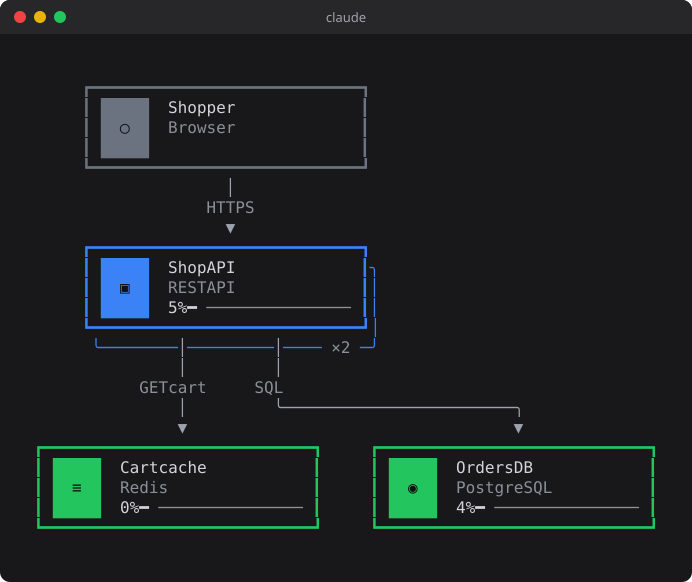

Proschi 0.12.0 draws diagrams inside Claude Code. When Claude answers with a
Proschi block, writes a `.proschi` file, or you run `/proschi view`, you get
the laid-out diagram in the terminal, not a wall of source.



## What shipped

The Proschi plugin for Claude Code now draws diagrams in three places:

- a ```` ```proschi ```` fenced block in Claude's reply. The plugin also tells
  Claude to answer with one instead of Mermaid or ASCII art when it shows an
  architecture or a request flow;
- a `.proschi` file Claude writes or edits, under the tool call;
- a file you name with `/proschi view <file>`, in a pane that redraws when
  the file changes.

Each drawing uses the same layout as the browser. It has the cards with their
tech icons, groups, stacked replicas and the legend. When the diagram has
`traffic`, each card shows the simulation's load.

Under the drawing there is a use case picker and a player like the editor's:
scenario tabs, the list of steps with each request and response, and play,
pause and step controls. Buttons copy the source or a share link, or open the
diagram in Proschi. **⛶ Focus** moves the diagram into a pane you drive with
the keyboard:

| Key | Does |
|---|---|
| `p` | Play or pause |
| `n` / `b` | Next or previous step |
| `r` / `e` | Restart, or jump to the end |
| `x` | Show or hide the use case explorer |
| `d` | Back to the diagram |
| `Esc` | Close the pane |

The full list is in [Diagrams in the terminal](../docs/AGENT-SKILLS.md#diagrams-in-the-terminal).
The change is [pull request #164](https://github.com/gvart/proschi/pull/164).

## What problem it solves

Before 0.12.0, when you asked Claude to sketch a design, you got Proschi
source in the reply. To see the diagram, you copied it into the editor or
opened a share link in the browser. To check a request flow, you read the
`usecase` block line by line.

Now the reply is the diagram. Ask *"show me how an order flows through the
checkout"* and you see the boxes, the arrows and the load on each node in
the same place you asked. Press play and the request moves from step to step.
When Claude edits a `.proschi` file in your repository, you see what the edit
did to the diagram under the tool call, before you open anything else.

## How to use it

1. Install the plugin in Claude Code, or update it if you already have it:

   ```text
   /plugin marketplace add gvart/proschi
   /plugin install proschi@proschi
   ```

   Already installed: `/plugin marketplace update proschi`.

2. Ask Claude for a diagram, for example *"draw our checkout as a Proschi
   diagram with a use case for placing an order"*. The reply is drawn.

3. To watch a file you edit yourself, run:

   ```text
   /proschi view checkout.proschi
   ```

   The pane redraws every time you save.

4. Pick **Place order** under the drawing and press play, or press
   **⛶ Focus** and then `p`.

This is the diagram from the picture above. Here it is live: press
**Play** to watch the order go through, or open it in the editor.

```proschi
user  "Shopper"    [Browser]
api   "Shop API"   [REST API]   x2
cache "Cart cache" [Redis]
db    "Orders DB"  [PostgreSQL]

user -> api   : HTTPS
api  -> cache : GET cart
api  -> db    : SQL

usecase "Place order" {
  user -> api   : POST /orders {"sku": "A1"}
  api  -> cache : GET cart
  api  -> db    : INSERT order
  api --> user  : 201 {"id": 42}
}

traffic {
  "Place order" 200 rps
}
```

When Claude puts this block in a reply, the plugin draws it as in the picture.

You need a Claude Code build with mod support (a plugin hooks module) and
Node 18 or newer on your `PATH`, because the layout runs in Node. The icons
are [Nerd Font](https://www.nerdfonts.com) glyphs. If your terminal font is
not a Nerd Font, set the plugin's `icons` option to `symbols`, which works
with any font, or to `none`.

## Who it is for

This is for you if you use Claude Code and design or review systems in
conversation with it: sketching a new service, explaining an existing one,
or checking a change to a `.proschi` file in your repository.

If you don't use Claude Code, nothing changes for you. The editor, the
[VS Code extension](../docs/EDITORS.md) and the `proschi` CLI work as before.

Some limits to know. It draws in a terminal only; anywhere else a reply shows
the block's source. Diagrams are fitted to the terminal's width (40 to 512
columns), so a wide diagram is cramped in a narrow window. The drawing is
read-only: to change it, edit the source or open it in the editor.
