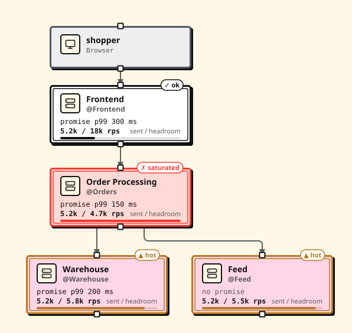
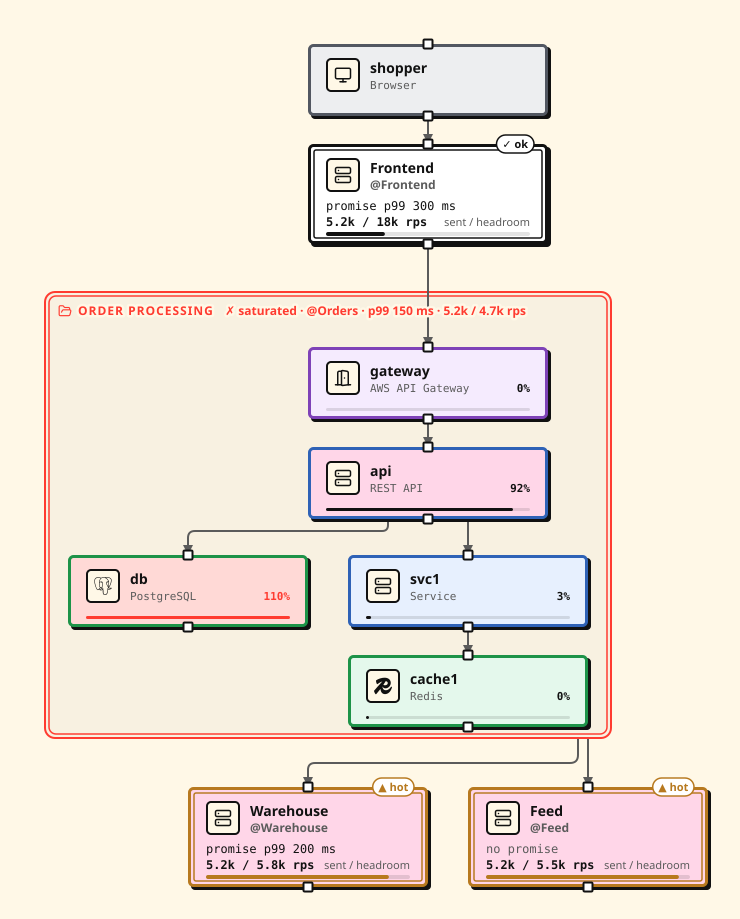

A `system` block draws a whole team as one box on an org diagram. The box
shows what the team promises and how much more it takes, worked out from that
team's own `.proschi` design. When your traffic is more than a team can take,
the simulation names the team and its node that gives out, so you can talk to
the owning team before you scale your part.



## What shipped

Team systems:

- A `system` block with `@team` for the owner, `from "teams/orders.proschi"`
  for the team's design, and `expose api "Orders API" -> "Place order"` for
  each entry point. Edges from outside reach only the entry points, so
  `frontend -> orders.db` is an error.
- A `capacity { … }` stub for a team with no design file yet.
- A derived contract on each box. The **promise** is the team's own
  requirements. The **headroom** is how much more load the design takes
  before a node runs hot (70%) and before one saturates.
- Warnings in plain words, and a `system:<id>` check that fails when a team
  saturates or breaks its SLA. Two callers of the same team file add up.
- Views: in the editor, *Open* shows the team's own diagram and source,
  *Expand* unfolds it inside the box, and *Collapse* folds it back.
  `proschi render` takes `--expand orders` and `--focus orders`. The Claude
  Code pane opens, enters and leaves systems with `o`, `f` and `u`.

Imports:

- Local `import` and `from` paths stay inside the project root: the folder of
  the nearest `proschi.json`, else the git repository, else the entry file's
  folder.
- Remote sources: `git:<host>/<org>/<repo>//<path>@<ref>` and `https://` URLs.
- `proschi imports sync` is the only command that uses the network. It pins
  each file in `proschi.lock` by commit and sha256.

**Breaking change:** a project with neither a `proschi.json` nor a git
repository can no longer import from a folder above the entry file. Add a
`proschi.json` (`{}` is enough) to the folder that holds both files.

## What problem it solves

A drone startup has four teams: Frontend, Orders, Warehouse and Feed, each
with its own design. Before, an org diagram either pulled every team's nodes
into one file or drew each team as a box the simulation could not check.

Now each team is one box, and its numbers come from its file. Raise the
launch traffic to 5.2k purchases a second and the render above marks Order
Processing as saturated. `proschi analyze` says why:

```text
'orders' cannot take what it is sent: you send 5.2k rps into "Place order"
(orders.api); it takes at most 4.7k rps before its db saturates. Its db is
at writes 5.5k rps of 5k rps, 110%.
```

You know whom to ask (the Orders team), which node runs out (its database)
and by how much, without opening their design. Expand the box to see it:



Imports had a quieter problem: a relative path could reach any file on your
disk. Now paths stay inside the project, and a file from another repository
is pinned by hash instead of copied by hand.

## How to use it

1. Put a `proschi.json` at the root of the project, unless it is a git
   repository:

   ```sh
   echo '{}' > proschi.json
   ```

2. Draw each team as a system. Link the teams that have a design:

   ```proschi fragment
   system orders "Order Processing" @Orders {
     from "teams/orders.proschi"
     expose api "Orders API" -> "Place order"
   }
   system warehouse "Warehouse" @Warehouse {
     from "git:github.com/drone-startup/warehouse//design/warehouse.proschi@v2.3.0"
     expose stock "Stock API" -> "Reserve stock"
   }
   ```

3. Fetch the remote files once, then commit the lock and ignore the cache:

   ```sh
   proschi imports sync
   echo ".proschi/" >> .gitignore
   git add proschi.lock .gitignore
   ```

4. Render the org, collapsed and with one team open:

   ```sh
   proschi render org.proschi --out docs/diagrams
   proschi render org.proschi --expand orders --out docs/diagrams
   ```

5. In CI, fill the cache from the lock and run the checks:

   ```sh
   proschi imports sync --frozen
   proschi test .
   ```

`proschi check`, `render`, the language server, the VS Code preview and the
Claude Code plugin read the cache and never fetch. The browser never fetches
either: `proschi share-link org.proschi` puts the team files in the link.

The browser cannot read `from` files, so this live version uses `capacity`
stubs. At 2k rps, Order Processing is sent more than its 1.2k rps:

```proschi
title "Drone startup" "Teams and what they promise each other"

shopper "Customer" [Browser]

system frontend "Frontend" @Frontend {
  expose web "Shop"
  capacity { 20k rps p99 300ms availability 99.95% }
}
system orders "Order Processing" @Orders {
  expose api "Orders API"
  capacity { 1.2k rps p99 150ms availability 99.9% }
}
system warehouse "Warehouse" @Warehouse {
  expose stock "Stock API"
  capacity { 3k rps p99 200ms availability 99.9% }
}
system feed "Feed" @Feed {
  expose events "Events"
  capacity { 10k rps p99 50ms availability 99.5% }
}

shopper  -> frontend.web    : HTTPS
frontend -> orders.api      : place order
orders   -> warehouse.stock : reserve
orders   -> feed.events     : order placed

usecase "Buy drone" {
  shopper  -> frontend.web    : open shop
  frontend -> orders.api      : place order
  orders   -> warehouse.stock : reserve
  orders  ->> feed.events     : order placed
  orders  --> frontend        : 201
  frontend --> shopper        : 200
}

traffic {
  "Buy drone" 2k rps
}
```

To try linked team files in the browser, pick **Drone startup (team
systems)** from the editor's examples. The full walkthrough is in
[Org diagrams and team systems](../docs/SYSTEMS.md), and the rules for imports
are in [Security model for imports](../docs/IMPORTS.md#security-model-for-imports).

## Who it is for

Read this if you review designs that cross team lines, or own one team's
part and want to know what the teams around you can take. It also matters if
you import `.proschi` files from another folder or repository.

If your diagrams fit in one file with no imports, nothing changes for you.

Some limits. A system's numbers are only as good as the team's design: a
team without `requirements` has no promise, and a stub is a number someone
wrote down. The web editor reads
remote team files only from a share link. In the Claude Code plugin, a
symlink that points outside the project is followed; `proschi check`
reports it.
