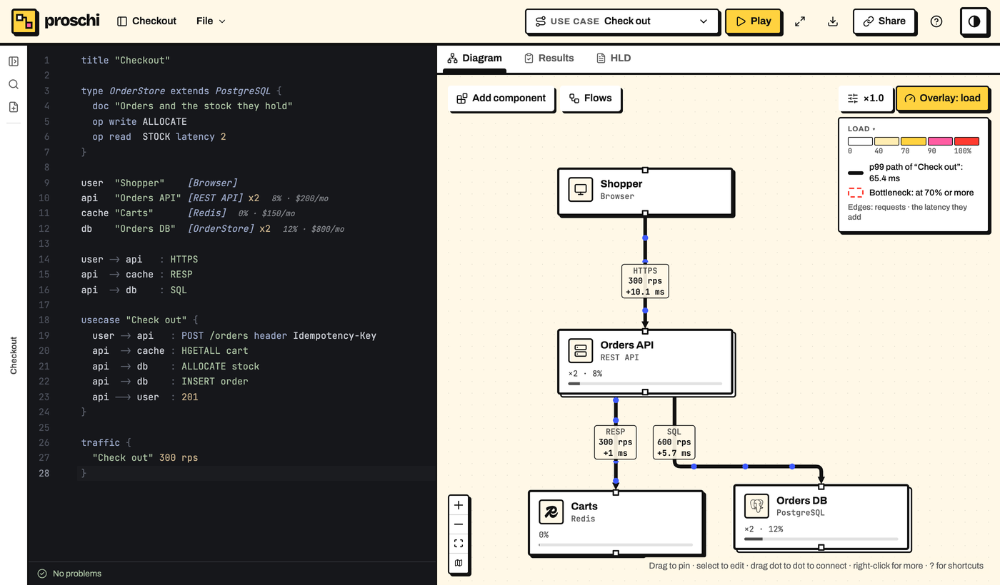
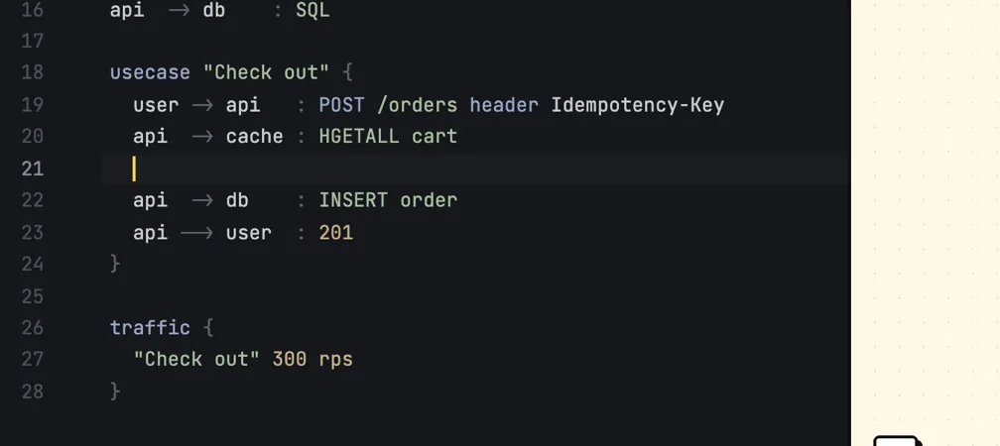
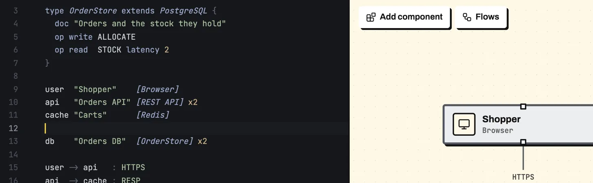
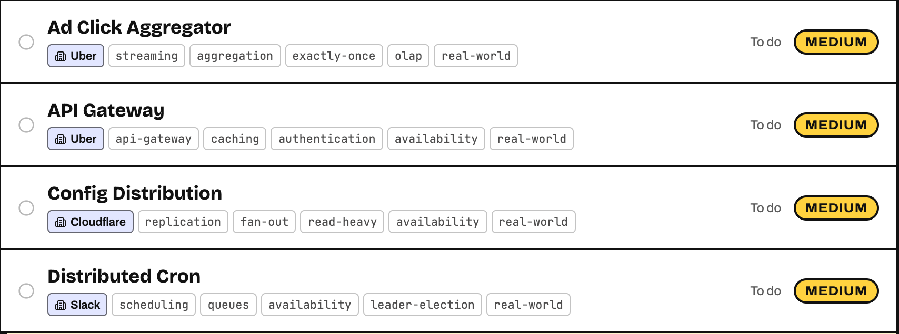
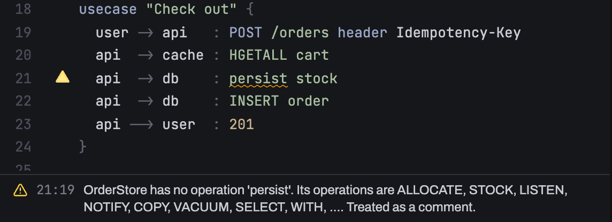
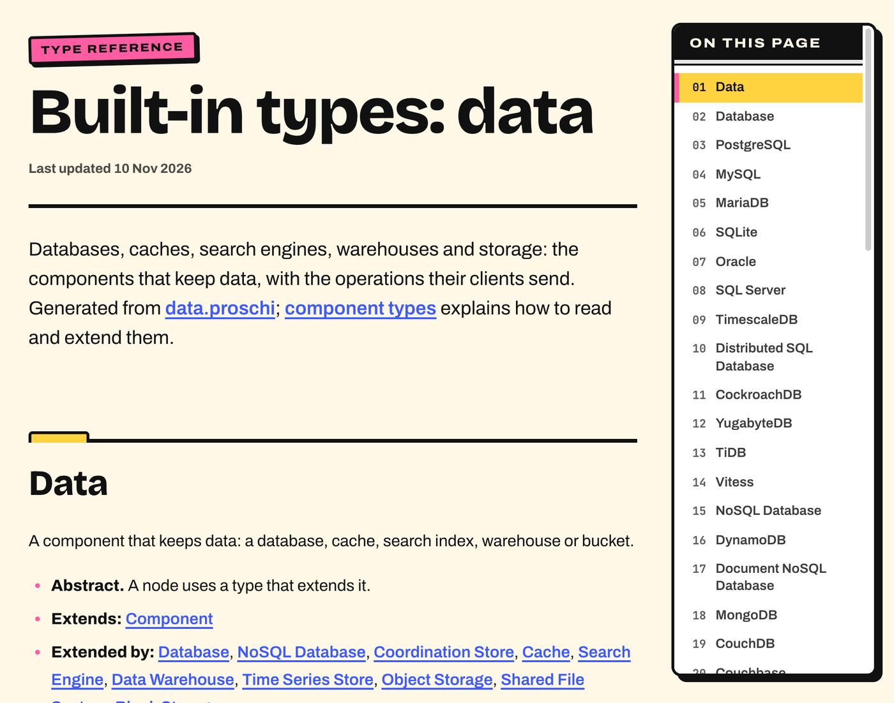

Every tech in a node's brackets is now a type. `[PostgreSQL]` knows
`SELECT` and `INSERT`, `[Redis]` knows `HGETALL` and `INCR`, and a
`[REST API]` knows its HTTP methods, statuses and headers. You can extend
any of them with `type … extends …`. This post covers 0.15.1 to 0.18.0.


## What shipped

### Types and operations (0.18.0)

- **`type Name extends Parent { … }`** declares a type. It inherits its
  parent's kind, simulation numbers, operations and icon, and can override
  them. `abstract type` declares one that only exists to be extended.
- **A built-in type for every catalog tech**, written in Proschi itself,
  with the operations of the real API: `op read`, `op write`, and `op
  forward` for gateways that pass a WebSocket frame on. `latency 2` and
  `cost 3` on an op scale that step's time and load.
- **`status` and `header`.** A response such as `--> user : 299` is checked
  against the type's statuses. A request can name headers:
  `POST /orders header Idempotency-Key`.
- **Checked steps.** A step whose label names no operation of its target's
  type gets a warning with a did-you-mean, and is treated as a comment.
  Types such as `[Service]` list no operations, so their labels stay free.
- **Typed tests:** `"Shorten" uses INSERT on db`, `calls api with GET /{code}`
  and `sends header Authorization to api`.
- **Strict practice.** All 40 problems now have `strict: true`, where an
  unknown operation is an error, and their tests check operations.
- **Editor support.** The web editor completes operations after the colon
  and shows a type's parent chain when it completes the type. The language
  server adds hover, go to definition, references and rename for types.
- **A reference** of every built-in type, starting at [Built-in types:
  data](https://proschi.app/docs/types-data/). Each docs page now shows
  when it was last updated.







### Simulation and canvas (0.18.0)

- **New quantities:** constants (`let peak = 120k rps`, used as `$peak`),
  peak traffic (`"Read" 20k rps peak x3`), a cache hit rate (`cache hit
  90%`), retries (`errors 2% retries 3`), queue drain and `lag`, and cost
  budgets per team, group or tag.
- **On the canvas:** rps and latency chips on each edge, the p99 path in
  bold, a ring on bottlenecks, a traffic slider and **Simulate down** in
  the right-click menu. Copy, paste, node search (`/`) and a minimap too.
- **`proschi diff`** in the CLI.

### Practice (0.16.0 and 0.17.0)

- **11 problems based on company engineering posts**, 40 in all: Netflix's
  load shedding, Uber's ad click aggregator, Cloudflare's config push,
  Slack's distributed cron and more. Each cites its source.
- A problems-first practice page, sign-up by email, and **Send feedback**.



### Playback (0.15.1)

A `-->` written after other steps now plays where you wrote it, and a
`par` block plays as one frame, a response inside it included.

## What problem it solves

Before, Proschi guessed reads and writes from words in the label. `persist
stock` to a database was a read or a write depending on a verb list, and a
typo went unnoticed. Now the type decides. `persist` is no operation of
PostgreSQL, so the editor says so at the word:



The same goes for practice. A cache-aside answer that sends `STORE` where
the test asks for `SET` fails that test, and the hint names the step to add.

## How to use it

1. Open the [editor](https://proschi.app/app/) and paste the design below.
2. Type `api -> db : ` in the use case. The list shows the operations of
   `OrderStore`, its own and PostgreSQL's.
3. Change `ALLOCATE stock` to `persist stock` and read the warning.
4. Check any design from the command line:

```sh
npx proschi check checkout.proschi
```

```proschi
title "Checkout"

type OrderStore extends PostgreSQL {
  doc "Orders and the stock they hold"
  op write ALLOCATE
  op read  STOCK latency 2
}

user  "Shopper"    [Browser]
api   "Orders API" [REST API] x2
cache "Carts"      [Redis]
db    "Orders DB"  [OrderStore] x2

user -> api   : HTTPS
api  -> cache : RESP
api  -> db    : SQL

usecase "Check out" {
  user -> api   : POST /orders header Idempotency-Key
  api  -> cache : HGETALL cart
  api  -> db    : ALLOCATE stock
  api  -> db    : INSERT order
  api --> user  : 201
}

traffic {
  "Check out" 300 rps
}
```

`OrderStore` keeps the PostgreSQL icon, and `ALLOCATE stock` counts as a
write. [Component types](../../docs/TYPES.md) has the full syntax, and
[typed assertions](../../docs/TESTS.md#typed-assertions) the new tests.



## Who it is for

Read this if your use cases name real calls (`INSERT`, `GET /orders`,
`PUBLISH`) and you want the simulation and the tests to trust them. If you
solve practice problems, expect strict checks: a made-up verb is now an
error there.

Some limits. A diagram that used free-text labels on databases or caches
gets warnings now; the steps still play, and each warning says how to fix
it. Read and write now come from the type, so a few Redis commands, such as
`LPOP` and `ZINCRBY`, now count as writes. Practice problems moved to
version 2, which restarts their leaderboards and stats.
