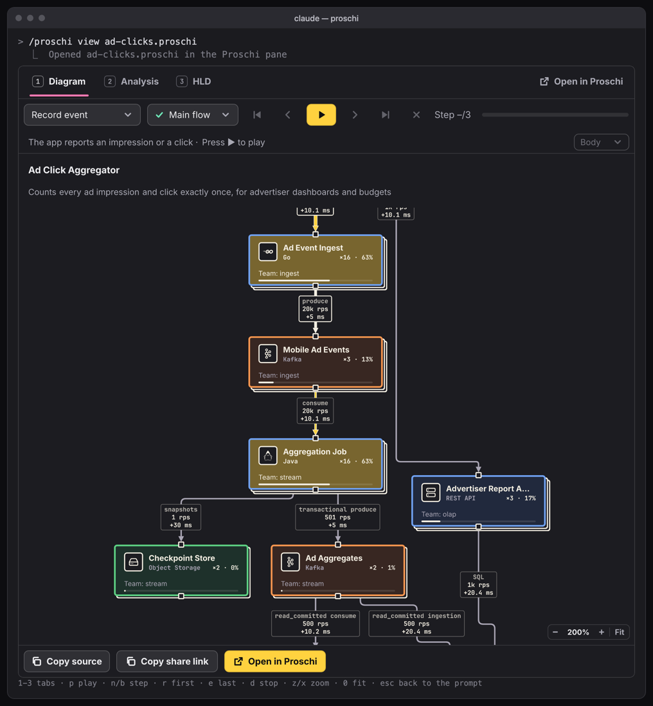
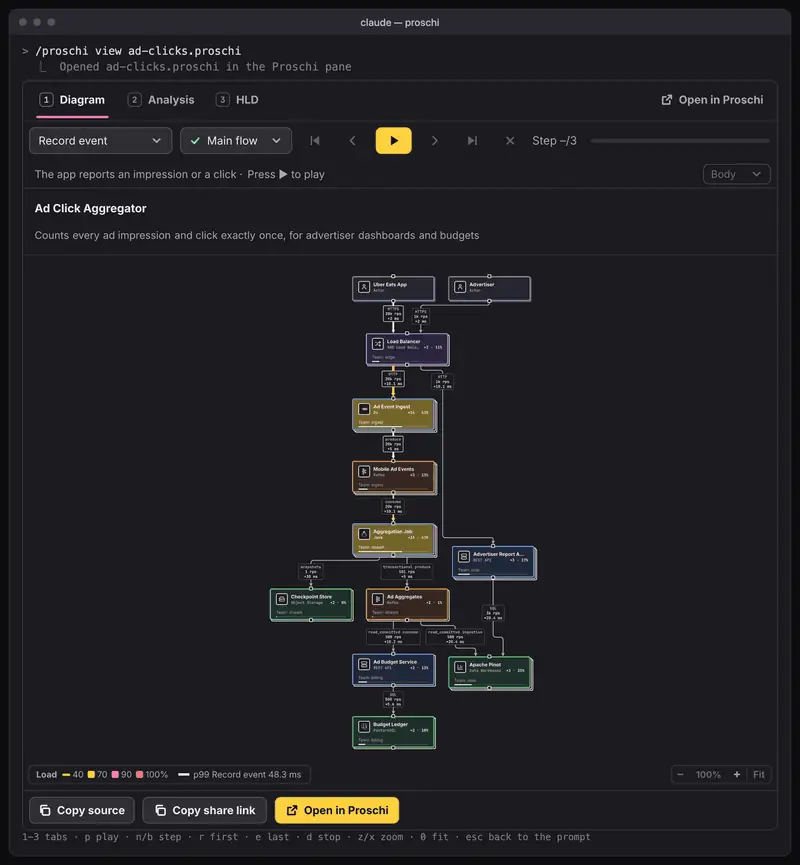

In kitty, Ghostty and iTerm2, the Proschi plugin for Claude Code now draws
its whole pane as pictures. The diagram is as sharp as the editor's canvas,
and the player, tabs and pages around it are buttons you press with the
mouse. A large design zooms to 300% and pans, so you can read one corner of
it.



## What shipped

- **Pictures or text, never both.** In a terminal that shows images,
  everything the pane draws is a picture, with no text preview first.
  Elsewhere, and inside tmux without passthrough, you get the text drawing.
  The new `graphics` option (`auto`, `on`, `off`) overrides the check.
- **Three tabs.** **Diagram**; **Analysis**, with cost, load and latency
  per node, percentiles per use case, queues, single points of failure and
  your `whatif` blocks; and **HLD**, the design document with numbered
  sections, tables and figures, and **⧉ Copy HLD markdown**.
- **A fixed player bar.** The use case and scenario pickers, the step
  buttons and **Body ▾** sit on top. Their menus open over the diagram, so
  nothing moves while you play.
- **Zoom and pan.** The pill in the diagram's corner zooms from fit to
  125%, 150%, 200% and 300%. A zoomed view is drawn again at that size, so
  the text stays sharp. Drag, the arrows or `h` `j` `k` `l` pan it.
- **The verdict only on failure.** One line under the diagram names the
  first failing check, and **⛶ Details** opens the HLD at its
  requirements.
- **Playback at about 30 frames a second.** Only the parts of the picture
  that change are drawn again.

Every change is in [pull request #208](https://github.com/gvart/proschi/pull/208).

## What problem it solves

Until now, the pane drew in text cells. That works for six nodes. A
design with 40 nodes and their edge labels doesn't fit in a terminal's
columns, so it got cut off or drawn too small to read, and the controls
around it were plain text too.

Now the same design is a picture the width of the pane. When it is too
small to read, the pane says so, and `z` zooms into the part you care
about. You can play the checkout use case at 200% and watch each call move
through the services it touches. Then press `2` to see which node is the
bottleneck, and `3` for the HLD.



## How to use it

1. Install or update the plugin:

   ```text
   /plugin marketplace add gvart/proschi
   /plugin install proschi@proschi
   /plugin marketplace update proschi
   ```

2. Open a design in the pane:

   ```text
   /proschi view shop.proschi
   ```

3. Use the mouse, or these keys:

   | Key | Does |
   |---|---|
   | `1`–`3` | Diagram, Analysis, HLD |
   | `p`, `n`, `b` | Play or pause, next step, previous step |
   | `z` / `x` | Zoom in or out |
   | `0` | Back to fit |
   | `h` `j` `k` `l`, arrows | Pan |
   | `c` | Copy the HLD as Markdown |

Try it with this design. Save it as `shop.proschi` and view it:

```proschi
title "Shop" "Takes orders and keeps the catalog fast"

shopper "Shopper" [Actor]

traffic {
  "Checkout" 500 rps
}

requirements {
  p99 "Checkout" < 300ms
}

api   "Shop API"  [REST API]   x3
cart  "Cart"      [Redis]
db    "Orders DB" [PostgreSQL] x2

shopper -> api : HTTPS
api     -> cart
api     -> db

usecase "Checkout" "Place an order from the cart" {
  shopper -> api  : POST /orders
  api     -> cart : GET cart:42
  cart   --> api  : items
  api     -> db   : INSERT order
  db     --> api  : ok
  api    --> shopper : 201
}
```

The full key list, the `graphics` and `cellAspect` options and the tmux
settings are in [Diagrams in the terminal](../../docs/AGENT-SKILLS.md#diagrams-in-the-terminal).

## Who it is for

It is for you if you design with Claude Code and want to check a design
where you already are: read it, play a request through it, see what it
costs, and copy the HLD into a pull request.

The pane is read-only. To edit the diagram, explore what-ifs live or solve
practice problems, **↗ Open in Proschi** opens the same design in the
editor. The pictures need kitty, Ghostty or iTerm2 3.5 or later, and Node
18 or newer. Text in a picture can't be selected, so each tab has a copy
button. Mouse wheel zoom isn't there yet: the wheel scrolls the pane.
