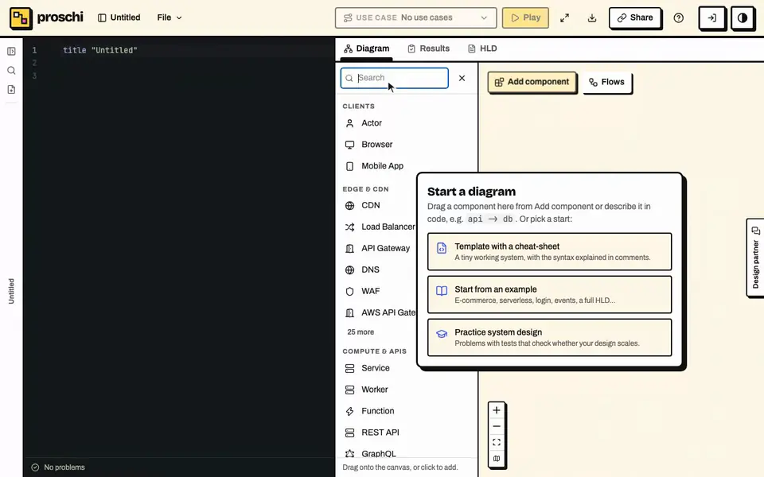
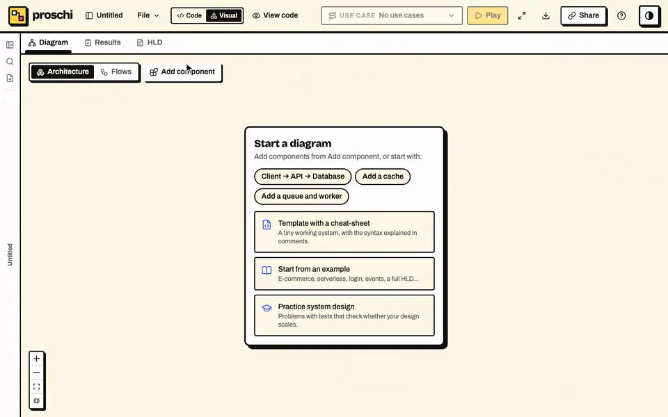
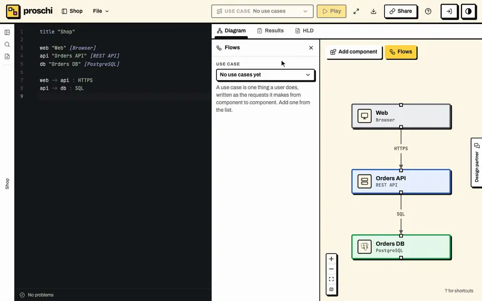
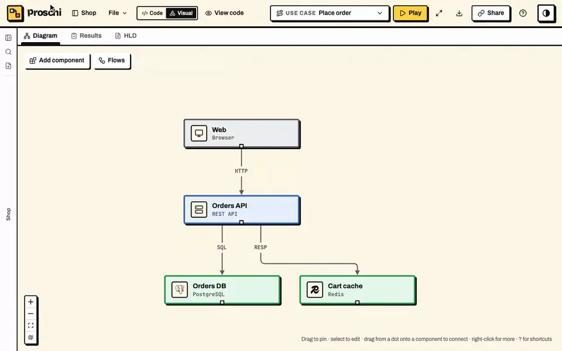
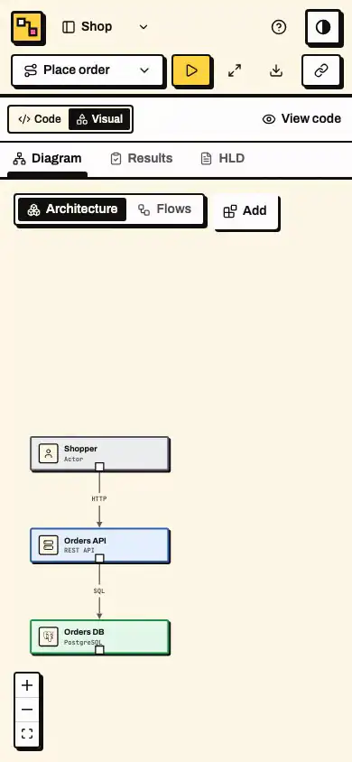

The Proschi editor now has a Visual mode. In it you build a diagram and its
use cases on the canvas, and the editor writes the text for you. The
operations, statuses and headers it offers come from each component's
type, so a step to PostgreSQL offers PostgreSQL's own operations.

## What shipped

- **Code and Visual modes.** A **Code | Visual** switch in the header, or
  **Ctrl+\\** (**⌘\\** on a Mac), replaces the side-by-side split. Visual
  gives the page to the canvas, with a rail of **Components** and
  **Selection** tabs and a read-only **View code** drawer. Code puts the
  text beside a diagram you can look at but not edit. A first visit opens
  in Visual, and the editor remembers your last mode.
- **Add connected.** With a component selected, a new one is added
  connected from it. Each node has a **+** for the same thing.
- **Names in place.** A new component starts with its name ready to type,
  and a generated id follows it: "Orders API" makes `orders_api`.
- **Protocol labels.** A new connection is labelled with the target
  type's protocol: `SQL` for PostgreSQL, `RESP` for Redis.
- **A command bar and canvas keys.** **A** or **Ctrl+K** opens the bar:
  type `redis`, press **Enter**. **Tab**, **C**, **T**, **F2**, **+**, **-**
  and **R** cover the rest.
- **Use cases as a sequence diagram.** The **Architecture | Flows** switch
  above the canvas, or **F**, turns the canvas into the use case: a lane per
  component, numbered steps, dashed responses, a frame with a tab per
  scenario and a small map of the architecture. Steps get their operations,
  statuses and headers from the target's type.
- **Parallel blocks without code.** Select several steps and **Run at the
  same time** wraps them in a `par` block.
- **Undo everywhere.** Every Visual edit can be undone. In Code mode,
  **Ctrl+Z** on the diagram undoes the last code edit.
- **A phone layout.** On a phone the rail is one sheet under the canvas,
  and the canvas gets shorter instead of covered.
- **AI that follows the mode.** In Visual, the Design partner and the
  Interview coach answer in components and connections, without code.

The work is in [pull request #230](https://github.com/gvart/proschi/pull/230)
and its follow-up.

## What problem it solves

Before, the code and the diagram always shared the screen. You dragged
each component from the palette, and it arrived alone, named after its
tech. You connected two of them dot to dot, then renamed one through a
dialog that left its id as `rest_api`.



Now each component takes a search and a name, and arrives connected from
the last one with its protocol on the arrow.



The old Flows panel built a use case as a plain list. It offered the same
hard-coded labels for every database, including a `query` operation that
PostgreSQL does not have.



Now you see the use case as a sequence diagram and edit it there. A **+**
between two steps starts a dashed arrow at that spot. Click the lane it goes
to and type its label, and the operations come from the target's type.
**Enter** adds the step and starts the next arrow where it went, so the
answer to a request is one more **Enter**. Click an arrow and a toolbar
under it changes its kind, moves it or deletes it.


Steps that happen together no longer need code. Shift-click two steps and
click **Run at the same time**. A frame marks the block, with **Ungroup**
on it. Scenarios get a frame too, with a tab for each: the tab you pick is
the one **Play** plays.


## How to use it

1. Press **Open in editor** on the live example below. On a first visit the
   editor opens in Visual.
2. Click **Orders API**, press **A**, type `redis` and press **Enter**.
   Name it `Cart cache` and press **Enter**. It is connected from the API
   with `RESP`.
3. Click **Flows** above the canvas. Hover the sequence diagram and click
   the **+** between steps 1 and 2.
4. Click **Cart cache** on the map in the corner (it has no lane yet), type
   `GET cart` and press **Enter**, then **Escape**.
5. Click **GET cart**, Shift-click **INSERT order**, then click **Run at
   the same time**.

```proschi
title "Shop"

shopper "Shopper" [Actor]
orders_api "Orders API" [REST API]
orders_db "Orders DB" [PostgreSQL]

shopper -> orders_api : HTTP
orders_api -> orders_db : SQL

usecase "Place order" {
  shopper -> orders_api : POST /orders
  orders_api -> orders_db : INSERT order
  orders_db --> orders_api : 1 row
  orders_api --> shopper : 201
}
```

Click a step to edit it on its arrow: **Enter** edits the label, and the
toolbar changes its kind. **Alt+↑** and **Alt+↓** move it, and **Delete**
removes it.

Switch to Code to edit the text. The diagram follows it.



Select a component to see it in the **Selection** tab. The type card
shows its type chain, protocol and the operations it reads and writes.
Press **T** to change the type.


On a phone, tap a component and the sheet opens on **Selection**.
**Flows** turns the page into a list of the steps, and a tap on a step
edits it in a sheet.



Every key is in
[Build a diagram without code](../../docs/VISUAL-EDITOR.md).

## Who it is for

It is for you if you think in boxes and arrows, are new to Proschi, or
practise system design and want to sketch fast. If you already write
Proschi, stay in Code mode: the text editor works as before.

The diagram in Code mode is view-only, so edits happen in the text there.
On a phone, Flows is a list of steps instead of a sequence diagram, and
each step's menu moves it instead of a drag.

