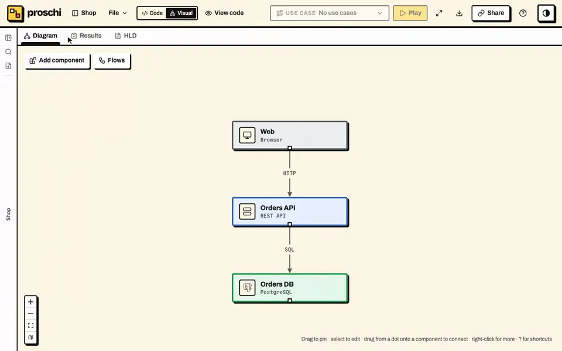

The Proschi editor now has a Visual mode. In it you build a diagram and its
use cases on the canvas, and the editor writes the text for you. The
operations, statuses and headers it offers come from each component's
type, so a step to PostgreSQL offers PostgreSQL's own operations.

## What shipped

- **Code and Visual modes.** A **Code | Visual** switch in the header, or
  **Ctrl+\\** (**⌘\\** on a Mac), replaces the side-by-side split. Visual
  gives the page to the canvas, with a rail of **Components**, **Flows** and
  **Selection** tabs and a read-only **View code** drawer. Code puts the
  text beside a diagram you can look at but not edit. A first visit opens
  in Visual, and the editor remembers your last mode.
- **Add connected.** With a component selected, a new one is added
  connected from it. Each node has a **+** for the same thing, and so does
  a connection let go on empty canvas.
- **Names in place.** A new component starts with its name ready to type.
  While its id is still the generated one, it follows the name: "Orders
  API" turns `rest_api` into `orders_api` everywhere.
- **Protocol labels.** Drop a connection anywhere on a node, and it is
  labelled with the target type's protocol: `SQL` for PostgreSQL, `RESP`
  for Redis.
- **A command bar and canvas keys.** **A** or **Ctrl+K** opens the bar:
  type `redis`, press **Enter**. **Tab**, **C**, **T**, **F2**, **+**, **-**
  and **R** cover the rest.
- **Flows from the types.** Operations, statuses and headers come from each
  component's type. Each step starts where the last one ended, **Reply**
  answers the open request, and you can edit, move and insert steps.
- **AI that follows the mode.** In Visual, the Design partner and the
  Interview coach answer in components and connections, without code.

Every change is in [pull request #230](https://github.com/gvart/proschi/pull/230).

## What problem it solves

Before, the code and the diagram always shared the screen. You dragged
each component from the palette, and it arrived alone, named after its
tech. You connected two of them by dragging between two small dots, then
renamed one through a dialog that left its id as `rest_api`.


Now the same client, API and database take a search and a name each. Each
one arrives connected from the last, with its protocol on the arrow. **A**,
`redis` and **Enter** add a cache to the API.


The old Flows panel offered the same hard-coded labels for every database:
`SELECT`, `INSERT`, `UPDATE` and `query`. PostgreSQL has no `query`
operation, so picking it gave you a warning in the code.


The new builder reads the target's type. PostgreSQL lists its own
operations, a REST API its HTTP methods, and a response the statuses of
the component that answers. After each step the next one starts where the
last ended, and **Reply** answers in one click.



## How to use it

1. Press **Open in editor** on the live example below. On a first visit the
   editor opens in Visual. After that it opens in your last mode.
2. Click **Orders API**, press **A**, type `redis` and press **Enter**.
3. Type a name and press **Enter**. The new cache is connected from the API
   with `RESP`.
4. Open **Flows**, pick **Place order** and click **Add a step** to add to
   the use case.

```proschi
title "Shop"

shopper "Shopper" [Actor]
orders_api "Orders API" [REST API]
orders_db "Orders DB" [PostgreSQL]

shopper -> orders_api : HTTP
orders_api -> orders_db : SQL

usecase "Place order" {
  shopper -> orders_api : POST /orders
  orders_api -> orders_db : INSERT order
  orders_db --> orders_api : 1 row
  orders_api --> shopper : 201
}
```

Switch to Code at any time to edit the text. The diagram follows it.


Select a component to see it in the **Selection** tab. The type card
shows its type chain, protocol and the operations it reads and writes.
Press **T** to change the type.


The whole walkthrough, with every key, is in
[Build a diagram without code](../../docs/VISUAL-EDITOR.md).

## Who it is for

It is for you if you think in boxes and arrows, are new to Proschi, or
practise system design and want to sketch fast. If you already write
Proschi, stay in Code mode: the text editor works as before.

The Flows builder shows and edits parallel blocks but can't create one:
write `par` in Code mode. The diagram in Code mode is view-only, so edits
happen in the text there.
