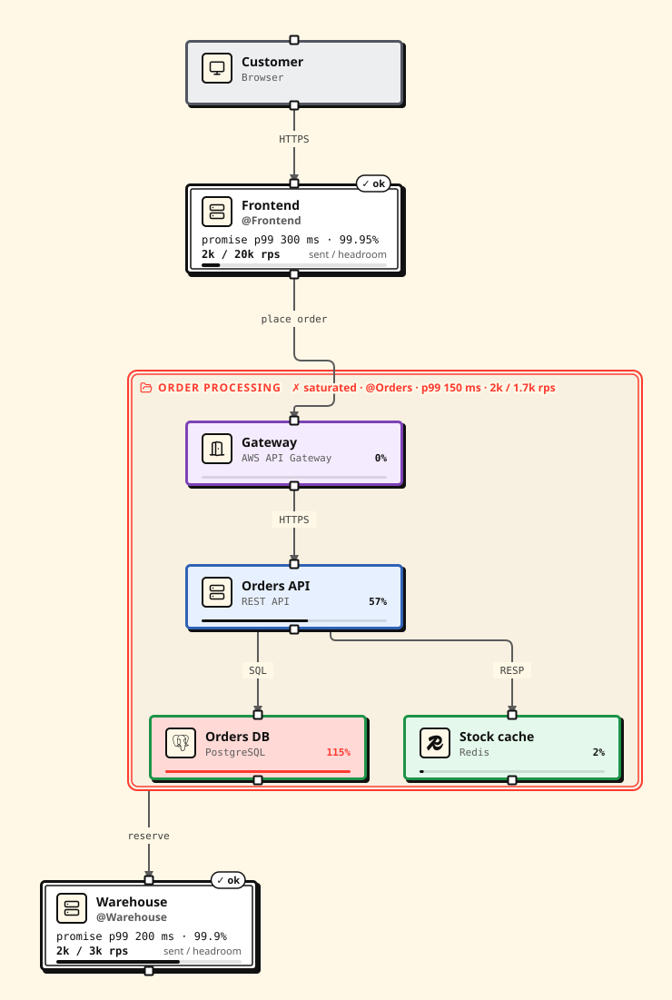

# Editor support

Proschi runs in your own editor and in CI as well as in the browser. The
editor plugins, the `proschi` command line and the web editor share one
parser, so they agree on what is valid.

| Editor | Install |
|---|---|
| IntelliJ IDEA, WebStorm, PyCharm and other JetBrains IDEs | [Proschi on the JetBrains Marketplace](https://plugins.jetbrains.com/plugin/34955-proschi) |
| VSCodium, Cursor, Windsurf, Gitpod and other Open VSX editors | [Proschi on Open VSX](https://open-vsx.org/extension/gvart/proschi) |
| VS Code | The `.vsix` file from Open VSX (see [VS Code](#vs-code)) |
| Neovim, Helix, Sublime Text, any editor with a language server client | The `proschi` npm package and a few lines of setup (below) |

Every plugin is built on two pieces from the `proschi` package:

- **The language server** (`proschi-language-server`): errors and warnings
  as you type, quick fixes (add a missing connection, replace an unknown
  tech stack), completion of keywords, node ids and tech stacks, hover, go
  to definition, find references, outline, formatting, and failing
  requirements and tests.
- **The command line** (`proschi`): checks, formats, renders and tests files
  in CI and pre-commit hooks.

A TextMate grammar for highlighting and a JSON Schema of the parsed diagram
are in the [Proschi repository](https://github.com/gvart/proschi/tree/main/tooling).

## Install

The command line and the language server are the `proschi` package on npm
(Node 18 or newer):

```sh
npm install -g proschi     # puts proschi and proschi-language-server on PATH
npx proschi check docs/    # or run it without installing
```

## VS Code

Editors that use Open VSX (VSCodium, Cursor, Windsurf, Gitpod) find
**Proschi** in their Extensions view.

In VS Code, download the `.vsix` from the
[Open VSX page](https://open-vsx.org/extension/gvart/proschi) (**Download**),
then **Extensions → … → Install from VSIX…**, or run:

```sh
code --install-extension proschi-<version>.vsix
```

Every [GitHub release](https://github.com/gvart/proschi/releases) has the
same file. The extension bundles the grammar and the language server.

**Proschi: Open Preview to the Side** (the preview button in the editor
title bar) opens the architecture and a scenario picker with that
scenario's sequence diagram. It updates as you type. While the document has
errors, it lists them above the last good rendering.

## IntelliJ IDEA and other JetBrains IDEs

Install [Proschi from the JetBrains Marketplace](https://plugins.jetbrains.com/plugin/34955-proschi)
under **Settings → Plugins → Marketplace**. It works in JetBrains IDEs
2025.3 and newer and brings:

- highlighting, bracket matching and comment toggling;
- the language server through the IDE's LSP client, with **Structure** and
  **Reformat Code**;
- **Tools → Proschi**: **Check File**, **Run Tests**, **Show Diagram
  Preview** (redrawn on save) and **Open in Proschi**.

It needs Node.js 18 or newer, and runs `proschi` from `PATH`, else through
`npx`. Set other paths in **Settings → Languages & Frameworks → Proschi**.

### Older IDEs, through LSP4IJ

For IntelliJ IDEA open-source builds, Android Studio or versions before
2025.3:

1. **Highlighting.** Unzip the `.vsix` from
   [Open VSX](https://open-vsx.org/extension/gvart/proschi), then add its
   `extension` folder under **Settings → Editor → TextMate Bundles → +**.
2. **Language server.** Install
   [LSP4IJ](https://plugins.jetbrains.com/plugin/23257-lsp4ij), then add a
   server under **Settings → Languages & Frameworks → Language Servers → +**
   with the command `proschi-language-server --stdio`, and on the
   **Mappings** tab the file name pattern `*.proschi` with language id
   `proschi`.

## Neovim (0.11+)

```lua
vim.filetype.add({ extension = { proschi = 'proschi' } })
vim.lsp.config('proschi', {
  cmd = { 'proschi-language-server', '--stdio' },
  filetypes = { 'proschi' },
  root_markers = { '.git' },
})
vim.lsp.enable('proschi')
```

## Helix

In `~/.config/helix/languages.toml`:

```toml
[language-server.proschi]
command = "proschi-language-server"
args = ["--stdio"]

[[language]]
name = "proschi"
scope = "source.proschi"
file-types = ["proschi"]
comment-token = "#"
language-servers = ["proschi"]
```

## Sublime Text

Save [proschi.tmLanguage.json](https://github.com/gvart/proschi/blob/main/tooling/grammar/proschi.tmLanguage.json)
into your `Packages/User` folder for highlighting. For the language server,
install the LSP package and add this to `LSP.sublime-settings`:

```json
{
  "clients": {
    "proschi": {
      "enabled": true,
      "command": ["proschi-language-server", "--stdio"],
      "selector": "source.proschi"
    }
  }
}
```

## CI

```sh
proschi imports sync --frozen              # only when the diagrams have git: or https:// imports
proschi check --strict --format github .   # warnings fail too; GitHub annotations
proschi fmt --check .                      # fails when a file is not formatted
proschi test --format github .             # requirements and tests
```

Directories are searched for `*.proschi` files, skipping dot folders and
`node_modules`.

| Command | Exit 1 when | Formats |
|---|---|---|
| `check` | a file has an error, or a warning with `--strict` | `text`, `github`, `json` |
| `fmt --check` | a file is not in the canonical layout | text |
| `test` | a requirement or test fails, or a file has errors | `text`, `github`, `json` |
| `imports sync --frozen` | `proschi.lock` is missing or would change | text |

Every command exits with 2 on bad usage. `proschi parse <file>` prints
`{"diagram": …, "diagnostics": […]}` as JSON that matches the JSON Schema,
so other tools can read the nodes, edges and use cases.

### GitHub Action

`gvart/proschi/action` checks and tests the diagrams in a repository. On a
pull request it keeps one comment up to date with what the changed diagrams
look like now.

```yaml
# .github/workflows/proschi.yml
name: Proschi
on:
  pull_request:
    paths: ['**/*.proschi', '.github/workflows/proschi.yml']
  push:
    branches: [main]
    paths: ['**/*.proschi']

permissions:
  contents: read
  pull-requests: write # the comment; leave it out (or set comment: false) for none

jobs:
  proschi:
    runs-on: ubuntu-latest
    steps:
      - uses: actions/checkout@v5
      - uses: gvart/proschi/action@tooling-v0.12.0
        with:
          files: docs/**/*.proschi   # default **/*.proschi
```

It runs `proschi check --format github` and `proschi test --format github`,
so errors and failing requirements show as annotations on their lines. The
job fails on an error or a failing requirement or test. Warnings never fail
it.

The comment has a row per changed `.proschi` file: nodes, tests passed,
requirements met, and, with traffic, the monthly cost and worst p99. Each
row has an **Open in Proschi** link, the same `#code=` link that
`proschi share-link <file>` prints, so nothing is uploaded. Below come the
failing checks and each diagram as Mermaid. The same summary goes to the job
summary, and the SVGs to a workflow artifact.

| Input | Default | Meaning |
|---|---|---|
| `files` | `**/*.proschi` | Globs, one per line or comma-separated; `!` excludes |
| `test` | `true` | Also run `proschi test` |
| `openapi` | none | `node=path/to/spec.yaml` per line, like `check --openapi` |
| `comment` | `true` | Comment on pull requests |
| `render` | `true` | Upload the changed diagrams as SVGs |
| `version` | the release of the tag | The `proschi` npm version, e.g. `0.12.0` or `latest` |
| `cli` | none | A built `dist/cli.cjs` to run instead of the npm package |
| `token` | `github.token` | The token for the comment |

Outputs: `check-failed`, `test-failed` (`true` or `false`) and
`artifact-url`.

The comment needs `pull-requests: write`. Without it, and on pull requests
from forks (whose token is read-only), the action skips the comment with a
notice and the checks still run. It never pushes to the repository.

Each `tooling-v<version>` tag pins the action and the `proschi` version it
runs. A branch such as `@main` runs that branch's version. On other CI
systems, run `npx proschi check` and `npx proschi test` directly.

## Formatting

`proschi fmt` rewrites files in the canonical layout: two spaces per block,
aligned columns in runs of nodes and of connections, single blank lines and
one trailing newline. It keeps strings, labels, comments, payloads and lines
with syntax errors as written, so formatting never changes what a file
means.

```sh
proschi fmt docs/            # rewrite every *.proschi below docs/ and list the changed files
proschi fmt --check docs/    # write nothing; list the files that need it, exit 1 if any
```

| Where | Format with |
|---|---|
| Web editor | **Diagrams → Format code**, or Shift+Alt+F |
| VS Code | **Format Document** (Shift+Alt+F) |
| JetBrains | **Reformat Code** |
| Neovim | `vim.lsp.buf.format()` |
| Helix | `:format` |
| Sublime Text | **LSP: Format File** |

## Checking against OpenAPI

`proschi check` compares the steps of your use cases with OpenAPI specs, so
the diagrams don't drift from the APIs. Map node ids to spec files (OpenAPI
3.0 or 3.1, YAML or JSON) in a `proschi.json`:

```json
{
  "openapi": {
    "orders": "specs/orders-api.yaml",
    "payments": "../payments/openapi.json"
  }
}
```

Paths are relative to `proschi.json`, and each file uses the nearest one in
its folder or above. `--openapi <node>=<spec>` (repeatable, relative to the
working directory) adds or overrides a mapping:

```sh
proschi check --openapi orders=build/openapi.yaml docs/checkout.proschi
```

Every step with an HTTP method that calls a mapped node is checked:

| Check | Example warning |
|---|---|
| The method and path exist | `GET /ordres/42: 'orders-api.yaml' has no path /ordres/42; did you mean GET /orders/{orderId}?` |
| The `-->` reply's status is documented, exactly, as a range (`4XX`) or by `default` | `Status 422 is not documented for POST /orders (documented: 201, 400)` |
| A JSON request body matches the schema | `Request body does not match the schema of POST /orders: /items/0/quantity must be integer` |
| A JSON response body matches the schema of its status | `200 response body does not match the schema of GET /orders/{orderId}: /status must be equal to one of the allowed values: "pending", "paid", "shipped"` |

- `/orders/42` and `/orders/{id}` both match `/orders/{orderId}`. A
  parameter is one segment, a literal path such as `/orders/latest` wins
  over a template, and query strings are ignored.
- When `servers[0].url` has a path (`/v1`), steps may include it or not.
- Schemas resolve local `$ref`s. `nullable` (3.0) is understood, `format` is
  not checked, and external `$ref`s are skipped.
- Payloads that aren't JSON, or aren't valid JSON, are skipped, so sketched
  payloads stay allowed. A failed call (`-x`) only has its endpoint checked.

The findings are warnings, so `check` passes unless you add `--strict`. A
spec that can't be read is an error on the node that uses it. The language
server reports the same findings as you type, for documents saved below a
`proschi.json`.

## Imports

The command line, the language server and the editor plugins resolve
[imports](IMPORTS.md) from the file system, relative to the importing file
and inside the [project root](IMPORTS.md#the-project-root). System `from`
files work the same way.

`git:`, `https://` and [`cloud:`](IMPORTS.md#cloud-sources) imports are read from a local cache that
`proschi imports sync` fills. It is the only command that uses the network.
Commit `proschi.lock`, add `.proschi/` to `.gitignore`, and run
`proschi imports sync --frozen` in CI. See
[syncing remote imports](IMPORTS.md#syncing-remote-imports).

- `proschi check` reports each problem under the file it occurs in
  (`infra.proschi:3:1: …`), even when only the importing file was named.
- `proschi parse` prints the merged diagram, with `file` on locations from
  imported files.
- The language server reads open documents before the disk, so unsaved
  changes count. An import whose file has errors gets one error on the
  import line (`'infra.proschi' has 2 errors`). Completion, hover and go to
  definition work across files.
- `proschi share-link <file>` prints an editor link that carries the
  document and every file it imports.

## Sign in from the command line

`cloud:` imports and `proschi versions` read the diagrams saved in your
Proschi account, so the command line needs to sign in once:

```sh
proschi login     # opens the browser to sign in with GitHub or Google
proschi whoami    # prints the account you are signed in to
proschi logout    # ends the sign-in and deletes the stored tokens
```

`proschi login` waits for the browser on a one-time local address
(`http://127.0.0.1:<port>/callback`), and prints the sign-in link for a
machine with no browser. Your password and session cookie never pass
through the command line. The tokens are stored in
`~/.config/proschi/credentials.json` (`%APPDATA%\proschi\` on Windows),
readable only by you.

Signed in, you can [sync `cloud:` imports](IMPORTS.md#cloud-sources) and
[read saved versions](VERSIONS.md#6-read-versions-from-the-command-line).

## Converting Mermaid and OpenAPI

A Mermaid diagram or an OpenAPI spec can become a Proschi document, as a
starting point to edit. In the web editor, use **Diagrams → Import Mermaid
or OpenAPI…**. On the command line:

```sh
proschi import mermaid architecture.mmd > architecture.proschi
proschi import openapi specs/orders.yaml -o orders.proschi
```

The result goes to stdout or `-o`, and what can't be converted goes to
stderr as warnings.

| Mermaid | Proschi |
|---|---|
| `flowchart` / `graph` | the architecture; a node's tech comes from its label (`Orders DB (Postgres)` → `[PostgreSQL]`), else its shape |
| `subgraph id [Title] … end` | `group id "Title" { … }` |
| `-->`, `---`, `-.->`, `==>`, `<-->` and the rest | connections; `~~~` only places nodes |
| `sequenceDiagram` | a use case named by its `title`; `participant` and `actor` become nodes |
| `->>` or `->`, `-)`, `-x` | a call `->`, a one-way send `->>`, a failed call `-x` |
| `-->>`, `-->` | the answer to the open call it replies to |
| `alt … else`, `opt`, `critical … option`, `par … and` | `alt` branches and `par` |

Markdown with several `mermaid` blocks, as `proschi render --format md`
writes it, reads as one document. Styling, notes and other diagram types are
left out with a warning.

An OpenAPI 3.0 or 3.1 spec becomes a starter design: a `client` actor, an
`api` node named after `info.title`, and a use case per operation, with its
first 2xx status. `proschi check --openapi api=spec.yaml` passes on the
result. With more than 20 operations, each tag becomes one use case with a
scenario per operation.

## Rendering and export

In the web editor, the **Export** menu next to **Share** has PNG and SVG
images of the whole diagram, Mermaid (**Copy Mermaid: architecture**,
**Copy Mermaid: this scenario**, **Download Mermaid (.mmd)**), the
`.proschi` file, and **Export all (.zip)**, a backup of every diagram in
this browser. The Mermaid flowchart keeps the diagram's
[colors](STYLING.md#colors-and-legend) but has no legend.

`proschi render` writes static files for docs sites, READMEs and wikis:

```sh
proschi render shop.proschi --out docs/diagrams              # SVG (default)
proschi render shop.proschi --out docs --format md           # docs/shop.md
proschi render shop.proschi --out site --format html         # site/shop.html
```

| Format | Output |
|---|---|
| `svg` | `architecture.svg` and a `<usecase>--<scenario>.svg` sequence diagram per scenario |
| `md` | `<file>.md`: a Mermaid architecture block and a Mermaid sequence block per scenario |
| `html` | `<file>.html`: one self-contained page with every SVG |
| `hld-md` | `<file>.hld.md`: the [HLD document](#hld-documents) with Mermaid diagrams |
| `hld-html` | `<file>.hld.html`: the same document as one page with every SVG |

`--out` defaults to the current folder. The SVGs use the editor's layout and
cards, need no fonts or stylesheets, and have a white background. A document
with errors in any of its files is not rendered: `render` prints them and
exits with 1.

[Team systems](SYSTEMS.md) are drawn as one box each. `--expand orders,feed`
opens systems in place (`orders.billing` opens its parent too), and
`--focus orders` draws one system's design alone. An id that names no system
exits with 2.



## Simulation and tests

A document with `traffic` gets a capacity model, and its `requirements` and
`test` blocks become checks that run in the web editor, on the command line
and in the language server. [How the simulation works](https://proschi.app/docs/model/)
has the model and its default numbers; [requirements and tests](TESTS.md)
has the syntax.

```sh
proschi test docs/                 # every *.proschi below docs/
proschi analyze shortener.proschi  # the capacity table
```

`proschi test` follows imports, prints each result with a hint for failures,
and exits with 1 when one fails. Files without requirements or tests pass.
`--format json` prints `id`, `name`, `category`, `passed`, `message`, `hint`
and `loc` per result.

`proschi analyze` prints, per node, reads and writes against capacity
(`3k/15k rps 20%`), utilisation, latency, availability, egress and cost,
then the total cost, latency percentiles per use case and scenario, and
single points of failure. `--format json` prints the whole analysis.

In the web editor, the **Results** tab lists failing checks first, each with
its hint, then the analysis and **Review my design**. Links with
`?view=results` open on that tab, and `?view=hld` on the HLD. In the
language server, failing requirements and tests are warnings on their
lines, and hovering a node shows its load and cost.

## HLD documents

Proschi turns a document into a high-level design (HLD) write-up, the
structure a design review expects. Sections without content are left out:

| Section | From |
|---|---|
| Overview | `title "Name" "Summary"`, the architecture diagram, counts of components, use cases and teams |
| Requirements | every use case and its scenarios, then each requirement and test with pass or fail and the measured value |
| Capacity estimates | the `traffic` table, and load, utilisation, replicas and cost per component |
| Components | name, tech, kind, team, replicas, responsibility (the node description), entities stored |
| Data model | `entity` blocks |
| APIs | use cases grouped by endpoint, with request bodies and responses |
| Scenarios | condition, share of traffic, latency and messages per scenario |
| Decisions | `decision` blocks: the choice, why, and the rejected options |
| Risks | failing checks, components over 70% busy, single points of failure, use cases without an error scenario |

In the web editor, the **HLD** tab shows it, with **Markdown** and **HTML**
downloads. On the command line:

```sh
proschi render shop.proschi --out docs --format hld-md     # docs/shop.hld.md
proschi render shop.proschi --out site --format hld-html   # site/shop.hld.html
```

The Markdown uses Mermaid blocks, which GitHub and GitLab render. The HTML
has no scripts or external files. The blocks behind it are in
[high-level design](HLD.md).

## Practice problems

The [practice page](https://proschi.app/practice/) has system design
problems with tests that run in the browser. To write one, see
[writing practice problems](PRACTICE.md): `proschi problem new <id>`
scaffolds a folder and `proschi problem check` validates them.
