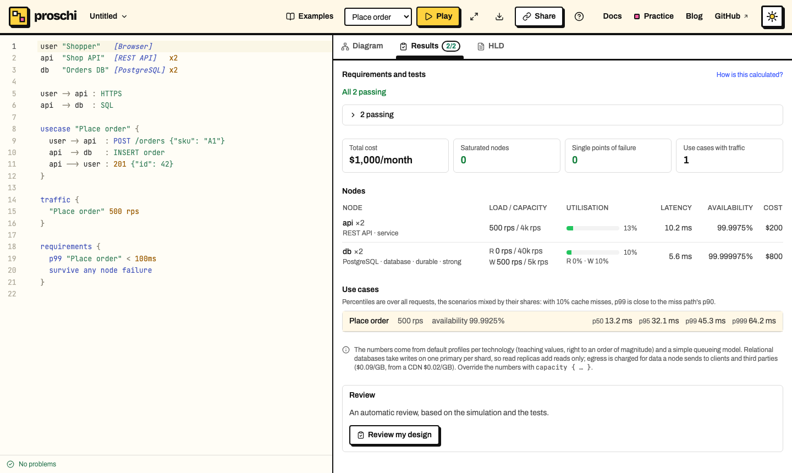

# Your first diagram in 2 minutes

You will end with a diagram, a request you can play, a failure path and a
requirement that checks itself. Every example is live: **Open in editor**
takes it to the [editor](https://proschi.app/app/).

## 1. Two boxes and an arrow

A node is an id, a name in quotes and a tech stack in brackets. An arrow
connects two nodes.

```proschi
api "Shop API"  [REST API]
db  "Orders DB" [PostgreSQL]

api -> db : SQL
```

The tech stack picks the icon and the numbers the simulation uses later:
`[PostgreSQL]` is a database, `[Redis]` a cache, `[Kafka]` a message broker.
About 210 are known, under the names people usually write (`[Postgres]`,
`[S3]`, `[k8s]`). [Nodes, groups and connections](NODES.md) has the rest.

> **Try it:** open it in the editor and add `cache "Cache" [Redis]` and
> `api -> cache : GET`. A third box appears and the layout makes room for it.

## 2. A request that flows

A **use case** is a request, step by step: `->` is a call and `-->` its
response. Press **Play**.

```proschi
user "Shopper"   [Browser]
api  "Shop API"  [REST API]
db   "Orders DB" [PostgreSQL]

user -> api : HTTPS
api  -> db  : SQL

usecase "Place order" {
  user -> api  : POST /orders {"sku": "A1"}
  api  -> db   : INSERT order
  api --> user : 201 {"id": 42}
}
```

Each step names its endpoint, payload or status, and follows a connection
you drew (the editor warns when one is missing). [Use cases](USE-CASES.md) covers fan-out, async calls
and payloads.

> **Try it:** press **Play** and watch the request reach the database and
> come back with `201`.

## 3. Break it on purpose

`alt` splits a use case into **scenarios** that share their first steps,
and `-x` is a call that never gets an answer.

```proschi
user "Shopper"   [Browser]
api  "Shop API"  [REST API]
db   "Orders DB" [PostgreSQL]

user -> api : HTTPS
api  -> db  : SQL

usecase "Place order" {
  user -> api : POST /orders {"sku": "A1"}
  alt "Created" {
    api  -> db   : INSERT order
    api --> user : 201 {"id": 42}
  } alt "DB down" {
    api  -x db   : INSERT order
    api --> user : 503
  }
}
```

> **Try it:** pick **Place order › DB down** and press **Play**. The request
> dies at the database, in red.

## 4. Ask whether it holds up

Say how much traffic comes in and what the design must do. The editor's
**Results** tab checks it as you type, with a deterministic model of load,
latency, availability and cost.

```proschi
user "Shopper"   [Browser]
api  "Shop API"  [REST API]   x2
db   "Orders DB" [PostgreSQL] x2

user -> api : HTTPS
api  -> db  : SQL

usecase "Place order" {
  user -> api  : POST /orders {"sku": "A1"}
  api  -> db   : INSERT order
  api --> user : 201 {"id": 42}
}

traffic {
  "Place order" 500 rps
}

requirements {
  p99 "Place order" < 100ms
  survive any node failure
}
```

`x2` runs two replicas, and both requirements pass.
[How the simulation works](https://proschi.app/docs/model/) explains every
number.



> **Try it:** open it in the editor and change `x2` to `x1` on `db`.
> *survive any node failure* turns red, because one database is a single
> point of failure.

## Go further

- [Scenarios](SCENARIOS.md): failure paths, [parallel steps](SCENARIOS.md#parallel-steps)
  and endpoint groups.
- [Requirements and tests](TESTS.md): every limit you can check.
- The [language reference](LANGUAGE.md): every statement.
- [Editor support](EDITORS.md): VS Code, IntelliJ, Neovim and CI.
