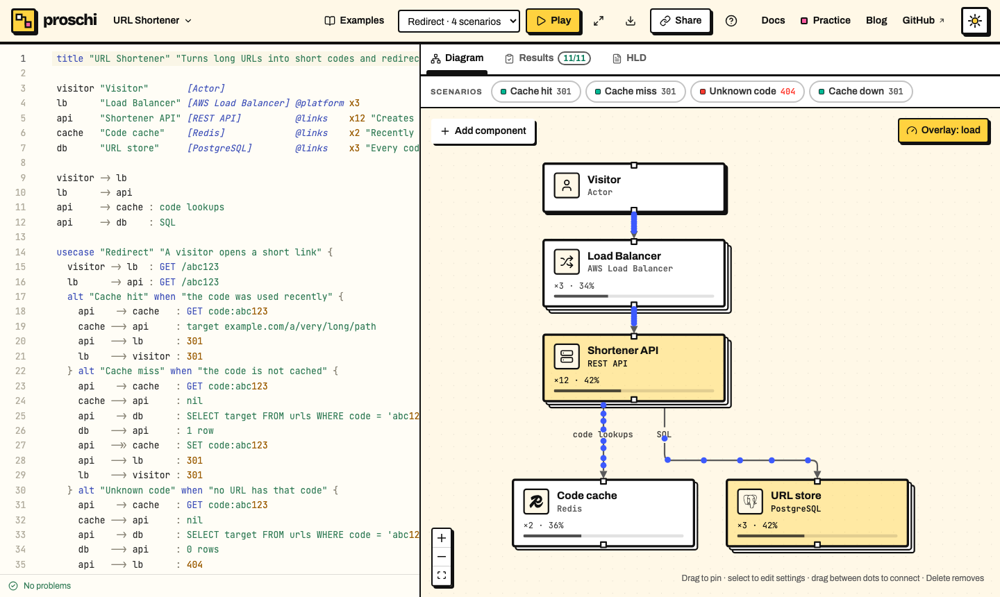

# Colors, legend and layout

A Proschi diagram is colored and laid out for you. You can also set colors,
name styles in a legend and steer the layout with three hints.

## Colors and legend

Nodes are tinted by category: clients gray, edge components (CDN, load balancer, gateway, DNS,
WAF) purple, services and functions blue, data stores green, queues and
brokers orange, external services pink. Groups and notes stay neutral, and
the tints follow the light and dark theme.

```proschi
legend {
  owned      "Owned by Order Fulfillment" green
  planned    "Planned flow"               blue dashed
  deprecated "Deprecated"                 red dashed
}

group fulfillment "Order Fulfillment" .owned {
  orders "Order Service" [REST API] critical
}
vendor "Vendor"     [Third Party API] color #0891b2
legacy "Legacy ERP" [SOAP API] .deprecated

orders -> legacy .deprecated : sync orders
orders -> vendor .planned    : quote
```

> **Try it:** change `red dashed` to `orange dotted` on the `deprecated`
> line, and watch the Legacy ERP border and its arrow change.

### Set a color by hand

`color` sets a node's or group's color. It takes a palette name (gray,
blue, teal, green, yellow, orange, red, purple, pink) or a hex value
(`#3b82f6` or `#38f`). From a hex value Proschi derives a fill light enough
for the text and a matching border, in both themes.

### Name styles in a legend

A top-level `legend` block names styles. Each line is an id, a label, and
optionally a color and `dashed` or `dotted`. A `.id` tag applies the style
to a node or group (fill and border) or a connection (the line). The legend
is drawn in a corner of the canvas and in exported images.

- An explicit `color` wins over the tag's color, which wins over the
  category's. While the load overlay is on, it colors the nodes instead.
- A hex color in a legend line needs the word: `old "Old" color #ef4444`. A
  bare `#` starts a comment.
- One tag per node, group or connection. Use case steps take none.
- An unknown tag or color name is an error that names the closest match.
- The Mermaid export keeps colors and dashes but not the legend.
- `critical` on a node draws a warning badge on its top-right corner.

## Steering the layout

The diagram is laid out top to bottom along the edges, and nodes in a row
keep their declaration order. Three hints steer it further. They change
positions, never meaning.

```proschi
title "Order Fulfillment"
layout ordered

shopper "Shopper" [Actor]           rank 0
pricing "Pricing" [Third Party API] rank 0

group core "Core services" rank 1 {
  orders "Order Service" [REST API]
}

group kafka "Kafka cluster" rank 2 {
  direction right
  placed  "Order placed"  [Kafka]
  shipped "Order shipped" [Kafka]
}

group data "Data" rank 3 {
  db [PostgreSQL]
}

shopper -> orders
orders  -> pricing : quote
orders  -> placed
orders  -> shipped
orders  -> db
```

| Hint | Where | What it does |
|---|---|---|
| `layout ordered` | top level | Of two connected nodes, the one declared first sits higher, even when the edge points up (`orders -> pricing`). Without it, only edges that close a cycle turn. |
| `rank N` | node or group header | Pins it to a layer among the items that share its parent. Lower ranks sit higher, equal ranks share a row, and `rank first` or `rank last` go above or below everything. |
| `direction down\|right\|up\|left` | top level or group | Turns the whole diagram (default `down`), or in a group, the flow among its members. Unconnected members line up the same way. |

Ranks order the layers but don't count them. A node without a rank still
goes where its edges pull it, which can be between two ranks.

### What the layout can't do

- Two connected nodes can't share a row: of two connected nodes with the
  same rank, the target goes one layer lower.
- A group with its own direction is laid out on its own and placed as one
  box. An edge into it ends at its border, across from the member it
  reaches.
- Fewer crossings win over declaration order.
- Where something has a rank, every label gets a layer of its own, so the
  diagram grows a little taller.

## Editing on the canvas

The text is the source of truth. Canvas edits are written back into it,
changing only their part of the line, so comments and alignment survive.

| On the canvas | In the text |
|---|---|
| Drag a node or group | `pos x,y` is added or updated. Positions inside a group are relative to the group. |
| Double-click a node | Its display name changes. |
| Drag from one node's dot to another's | A connection is added. |
| **Add component**, then pick one | A declaration is added above the first use case. |
| Select a node, then change its settings | Name, tech stack, replicas, owner and description change its declaration. Capacity, latency, availability, cost and shards change its [capacity](HLD.md#capacity) line, which is added when there is none. |
| Select a connection, then change its label | The label changes, unless it has a JSON or XML payload. |
| Select, then **Delete** | The node and its connections, or the connection, are removed. |
| **Auto-layout** | Every position is removed. |

Editing a node that was only referenced, never declared, adds its
declaration above the first use case. A node with `pos x,y` keeps its
place.

With traffic in the document, **Overlay: load** colors each node by how busy
it is and shows its replicas, shards and utilization. Dots flow along the
connections: hollow for async work, red when they fall off a node past 100%.



## Go further

- [Nodes, groups and connections](NODES.md): the parts each line takes.
- [Rendering and export](EDITORS.md#rendering-and-export): images and
  Mermaid with these styles.
