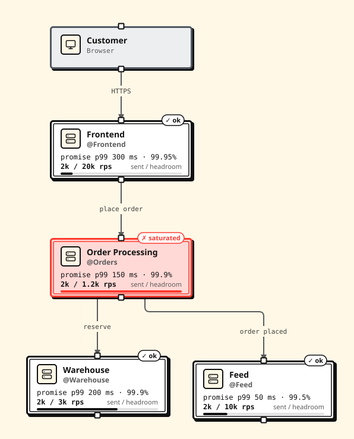
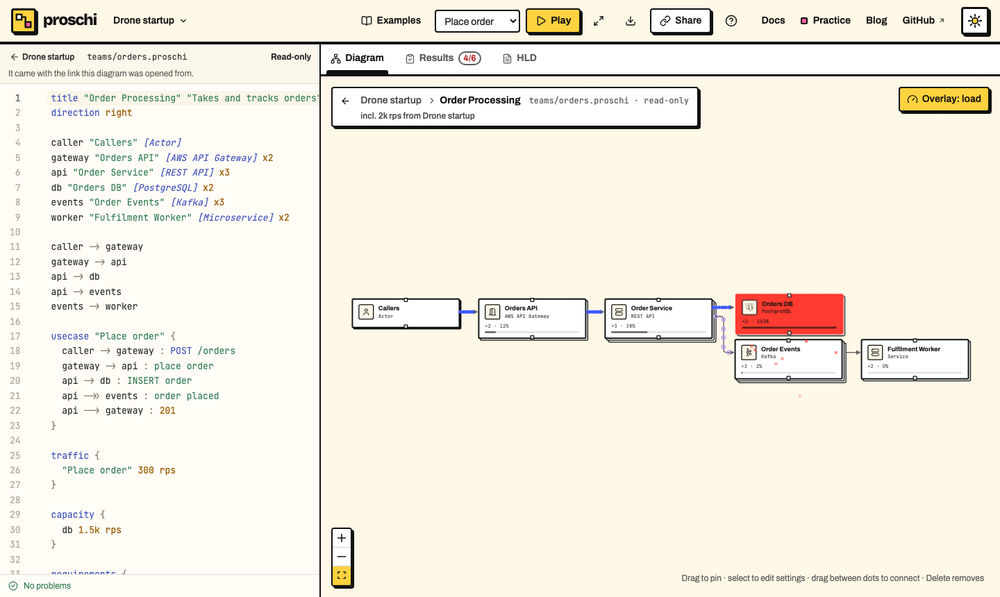

# Org diagrams and team systems

Most requests cross several teams, and each team owns its own design. An org
diagram draws each team as one box and connects the boxes. When you raise the
traffic, the simulation tells you which team cannot take it, without opening
any box.

The syntax is in [The system block](#the-system-block) and
[Imports](IMPORTS.md). To see a finished org diagram, pick
*Drone startup (team systems)* in the editor's *Examples* menu.

## 1. Draw one box per team

Each team is a `system` block. Until a team has a design file, give it a
`capacity` stub: the rate it takes, and the p99 and availability it promises.

```proschi
title "Drone startup"

shopper "Customer" [Browser]

system frontend "Frontend" @Frontend {
  expose web "Shop"
  capacity { 20k rps p99 300ms availability 99.95% }
}
system orders "Order Processing" @Orders {
  expose api "Orders API"
  capacity { 1.2k rps p99 150ms availability 99.9% }
}
system warehouse "Warehouse" @Warehouse {
  expose stock "Stock API"
  capacity { 3k rps p99 200ms availability 99.9% }
}
system feed "Feed" @Feed {
  expose events "Events"
  capacity { 10k rps p99 50ms availability 99.5% }
}

shopper  -> frontend.web    : HTTPS
frontend -> orders.api      : place order
orders   -> warehouse.stock : reserve
orders   -> feed.events     : order placed

usecase "Buy drone" {
  shopper  -> frontend.web    : open shop
  frontend -> orders.api      : place order
  orders   -> warehouse.stock : reserve
  orders  ->> feed.events     : order placed
  orders  --> frontend        : 201
  frontend --> shopper        : 200
}

traffic {
  "Buy drone" 2k rps
}
```

- `expose web "Shop"` is the team's entry point. You connect to
  `frontend.web`, never to what is inside the team.
- `@Frontend` names the owning team.
- The use case and `traffic` say how requests travel between the teams, and
  how many.

## 2. Find the team that cannot keep up



Open the example in the editor. Order Processing is flagged as saturated: it
is sent 2k rps and takes 1.2k. The check `system:orders` fails, and the
*Systems* table in the *Results* tab shows each team's load against what it
takes.

Change the traffic to `1k rps` and every team holds. A team above 70% of its
capacity is shown as running hot, which is a warning, not a failure.

## 3. Link a team's real design

A stub is a promise someone wrote down. Replace it with `from`, pointing at
the team's own `.proschi` file, and map the entry point to one of its use
cases:

```proschi fragment
system orders "Order Processing" @Orders {
  from "teams/orders.proschi"
  expose api "Orders API" -> "Place order"
}
```

The team file is an ordinary diagram with its own traffic and requirements.
Its requirements become the box's promise. The load you send is added to the
team's own traffic, so the simulation names the node that gives out first.
The team file's ids stay in its own scope.


The path must stay inside the [project root](IMPORTS.md#the-project-root).

## 4. Look inside

- **Web editor**: *Open* (or a double-click) shows the team's own diagram and
  source. *Expand* unfolds it inside the box. Breadcrumbs lead back.
- **Command line**: `proschi render org.proschi --expand orders` unfolds a
  team, and `--focus orders` draws only its design. See
  [Rendering and export](EDITORS.md#rendering-and-export).
- **Claude Code**: see [Diagrams in the terminal](AGENT-SKILLS.md#diagrams-in-the-terminal).



To open the whole org in a browser, with every team file inside the link, run
`proschi share-link org.proschi`.

## 5. Use a design from another repository

A `from` (or an `import`) can name a file in a git repository at a tag,
branch or commit:

```proschi fragment
system warehouse "Warehouse" @Warehouse {
  from "git:github.com/drone-startup/warehouse//design/warehouse.proschi@v2.3.0"
  expose stock "Stock API" -> "Reserve stock"
}
```

Fetch it, then commit the lock file and ignore the cache:

```sh
proschi imports sync
echo ".proschi/" >> .gitignore
git add proschi.lock .gitignore
```

`proschi imports sync` is the only command that uses the network. It uses
your own `git` and credentials. Every other command, and the editors, read
the cached copy. In CI, run `proschi imports sync --frozen` before
`proschi test`: it fails instead of changing the lock.

## The system block

```proschi fragment
system id ["Name"] [@team] [pos x,y] [color c] [.tag] [rank N] {
  …
}
```

A system goes at the top level or inside a group. `system` is a keyword only
on a line that ends with `{`, so a node may still be called `system`. Inside
the block, one line each:

| Line | Meaning |
|---|---|
| `from "path"` | The team's design file, found like an [import](IMPORTS.md): a local path, `git:` or `https://`. |
| `expose id ["Name"] [-> "Use case"]` | An entry point, and the team's use case it enters. Without a `from`, leave the use case out. With one, you may leave it out when the team file has a single use case. |
| `capacity { … }` | A stub for a team with no design file: the rate where it saturates, and its `p99` (or `latency`) and `availability`. |

- **Entry points.** `orders.api` names an entry point, with no space before
  the dot, and `orders` the whole box. A step may use `orders` alone only
  when the system has one entry point.
- **Scope.** The team file's ids, traffic, requirements and tests never
  clash with yours. From outside you reach only exposed entry points, so
  `web -> orders.db` is an error.
- **Promise and headroom.** The promise is the team's own requirements for
  the entry point's use case. The headroom is how much more load that use
  case takes before a node runs hot (70%) and before one saturates (100%).
- **Load.** What you send to an entry point is added to the team's own
  traffic for that use case, and the team design is simulated under the
  sum. Systems that use the same file share that load. In your diagram the
  system is one hop, with that use case's latency and availability.
- **Checks.** Each system that gets load has a result `system:<id>`. It
  fails when the system saturates or breaks its SLA. Running hot is a
  warning.
- **Nesting.** Team files may contain systems. A cycle of `import` and
  `from` files is an error, and problems in a team file are reported with
  its path.
- **Warnings**: a `from` and a stub together (the file wins), neither (not
  simulated), or no `expose`.

## Go further

- [Remote sources](IMPORTS.md#remote-sources) and
  [syncing](IMPORTS.md#syncing-remote-imports): updating a ref, and what
  `--frozen` checks.
- [Security model for imports](IMPORTS.md#security-model-for-imports): what
  Proschi guarantees about imported files.
- [Requirements](TESTS.md#requirements): the team file's requirements
  become the box's promise.
