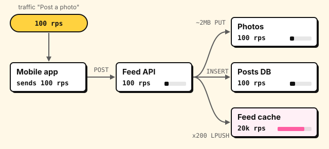

# Use cases

A use case is a request flow, written step by step over the architecture.
You play it in the editor, and the simulation reads its steps to work out
each request's load, latency and cost.

```proschi
title "Photo feed"

user  "Mobile app"  [Mobile App]
api   "Feed API"    [REST API]
db    "Posts DB"    [PostgreSQL]
cache "Feed cache"  [Redis]
blobs "Photos"      [AWS S3]

user -> api   : HTTPS
api  -> db    : SQL
api  -> cache : RESP
api  -> blobs : HTTPS

usecase "Post a photo" "Upload, save, fan out to followers" {
  user -> api   : POST /posts {"caption": "Sunset"}
  api  -> blobs : ~2MB PUT /photos/{id}
  api  -> db    : INSERT post
  api  -> cache : x200 LPUSH feed:{follower}
  api --> user  : 201 {"id": 42}
}
```

> **Try it:** press **Play** on "Post a photo", and each step lights up its
> arrow in turn, ending with the 201.

The block is `usecase "Name" ["Description"] { … }`, at the top level.

## Use case steps

Each step is an arrow between two nodes, and a label:

| Arrow | Meaning |
|---|---|
| `a -> b : …` | A synchronous request: a waits for the answer. |
| `a ->> b : …` | An asynchronous message, fire and forget, unless a reply follows. |
| `b --> a : …` | The response to the latest unanswered request from a to b. |
| `a -x b : …` | A failed call that never gets an answer: a timeout, a refused connection. |

The label is free text, but some shapes have a meaning:

- **HTTP.** A label that starts with GET, POST, PUT, PATCH, DELETE, HEAD or
  OPTIONS and a path sets the endpoint. The path may have placeholders such
  as `/orders/{id}`.
- **Headers.** Right after the path, `header` and comma-separated names
  list the request's headers: `GET /feed header Authorization, If-None-Match`.
- **Payload.** After the path (and any headers), a body that starts with `{`, `[` or `<` is
  JSON or XML, or name it with `json`, `xml` or `text`. A JSON body may span
  lines until its brackets balance.
- **Status.** On a response, a leading three-digit number is the status
  code.
- **Step name.** Any other text names the step, such as `INSERT post`.

The command line can [check these steps against OpenAPI](EDITORS.md#checking-against-openapi)
specs.

## Fan-out and payload size

Two optional prefixes on a request label say how much work a step is:

| Prefix | Meaning |
|---|---|
| `x<N>` | N calls per request (N ≥ 1). Load counts all N; latency counts one, as if batched. |
| `~<size>` | Payload size in B, KB, MB, GB or TB (decimal: 1 MB is 1000 KB). Adds transfer time and egress cost. |

They come in either order, at the very start of a request label, followed
by a space. So "xml payload" and "GET /x200" read as written. A zero count,
a repeated prefix and a malformed size (`~2mb`, `~MB`) are errors.
Responses and connection labels take no prefixes.



## Reads and writes

The simulation counts reads and writes apart, since a store takes far fewer
writes than reads. Each request step is one or the other:

1. **When the target's type lists operations**, the operation the label
   names decides. See [typed operations](#typed-operations).
2. **With an HTTP method:** POST, PUT, PATCH and DELETE write. GET, HEAD and
   OPTIONS read.
3. **Otherwise the first word of the label decides**, after any prefixes,
   ignoring case, whole words only. The verbs below write.
4. **Everything else reads**: SELECT, QUERY, SCAN, FETCH, an event name
   such as OrderPlaced, and so on.

| Write verbs | Typical labels |
|---|---|
| INSERT, UPDATE, UPSERT, DELETE, CREATE | INSERT order, UPDATE seat SET held |
| PUT, SET, WRITE, APPEND, SAVE, STORE, UPLOAD, COMMIT, RECORD, MARK | PUT pastes/k7Qz2, STORE body, MARK paid |
| PUTITEM, UPDATEITEM, DELETEITEM, BATCHWRITEITEM | DynamoDB: PutItem Url |
| INCR, INCRBY, DECR, HINCRBY, LPUSH, RPUSH, ZADD, HSET, SADD, XADD, MSET, GEOADD | Redis: INCR rate:42, ZADD feed:7 p_981 |
| RESERVE, HOLD, BOOK, CHARGE | Claiming a resource or money: HOLD seat 12A, CHARGE card |
| PUBLISH, SEND, ENQUEUE, PRODUCE, EMIT, NOTIFY | Handing something on: EMIT OrderShipped, NOTIFY bob |

Words that only start like a verb (Stored, Booking, Notification) read.
[Durability requirements](TESTS.md#requirements) count write steps only.

A step's protocol is inferred too: messaging for an async arrow or a queue
or broker target; REST for an HTTP method (or GraphQL, gRPC or SOAP when the
target's tech says so); "other" for the rest.

## Typed operations

A node's [component type](TYPES.md) may list the operations its clients
send. A request to such a node names one with its HTTP method, or with the
first words of its label after any prefixes, ignoring case:

```proschi
title "Typed steps"

user "Reader"   [Browser]
api  "Feed API" [REST API]
db   "Posts DB" [PostgreSQL]

user -> api : HTTPS
api  -> db  : SQL

usecase "Read the feed" {
  user -> api : GET /feed header Authorization
  api  -> db  : SELECT posts
  api --> user : 200
}
```

> **Try it:** change `SELECT posts` to `load posts`, and Proschi warns
> that PostgreSQL has no operation `load`.

- **The operation decides the access.** `op read` makes the step a read and
  `op write` a write, even where the verb table above says otherwise:
  Redis `DEL` and `LPOP` write. A request to a queue or a broker always
  writes.
- **Forwarding.** An `op forward` operation, such as `MESSAGE` on the load
  balancers and gateways, passes a WebSocket frame on. The step takes the
  access of the next step its target sends, the one that handles the frame.
- **Unknown operations warn.** A label that names none of the type's
  operations gets a warning at the word, with a suggestion or the list of
  operations. The step keeps the access the verb table gives it. See
  [fix an unknown operation](TYPES.md#fix-an-unknown-operation).
- **Statuses and headers are checked.** A response's status must be one the
  responding type lists, and each header in `header …` one the target's
  type lists, when the type lists any. Otherwise they warn too.
- **Open vocabularies.** A type with no operations, such as `[Service]` or
  `[Go]`, takes any label, read by the verb table. So does a node whose
  tech stack is not in the catalog.

An operation's `latency` and `cost` multipliers change that step's time and
load on the target; see [operations](TYPES.md#operations-reads-and-writes).

## Steps follow the architecture

A step between two nodes that no connection joins, in either direction, is a
warning, and the language server offers to add the connection. A node may
call itself, and a document with no connections at all is not checked.

## Go further

- [Scenarios](SCENARIOS.md): success and failure paths, and parallel steps.
- [Traffic](HLD.md#traffic): requests per second for each use case.
