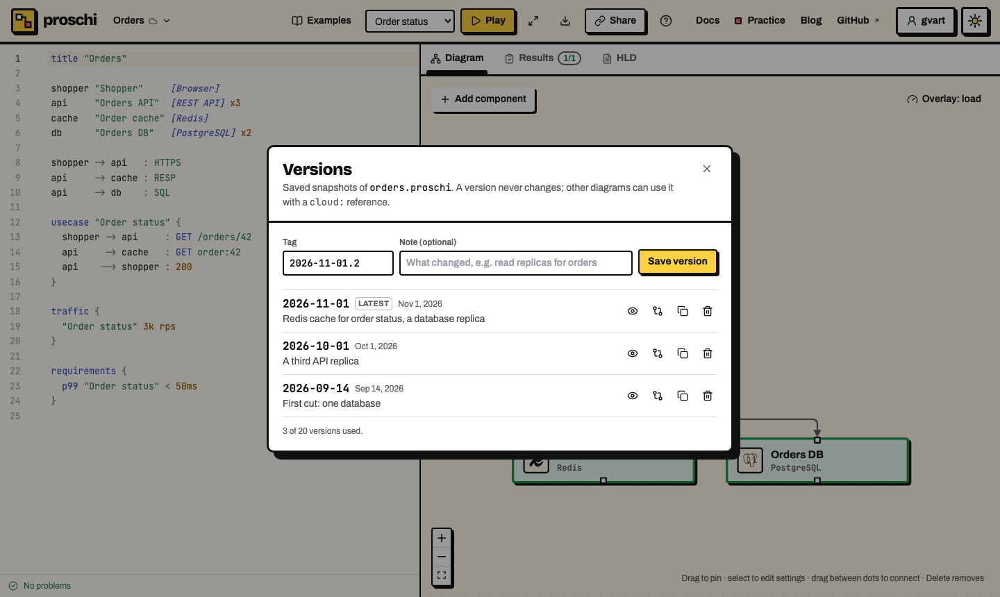
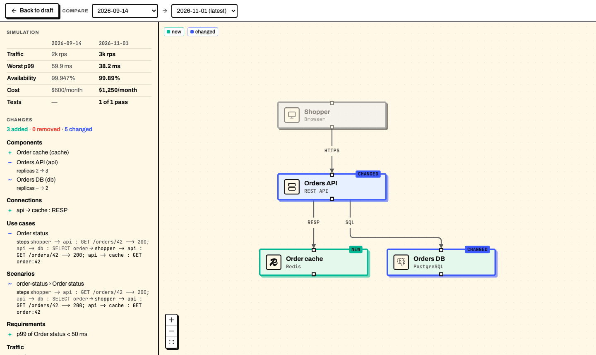

# Save and compare diagram versions

A version is a saved snapshot of a diagram that never changes. Save one each
time the design moves on, then compare any two to see what changed, and let
other diagrams use a version by its tag.

The examples on this page use one design, saved as `orders.proschi`:

```proschi
title "Orders"

shopper "Shopper"     [Browser]
api     "Orders API"  [REST API] x3
cache   "Order cache" [Redis]
db      "Orders DB"   [PostgreSQL] x2

shopper -> api   : HTTPS
api     -> cache : RESP
api     -> db    : SQL

usecase "Order status" {
  shopper -> api     : GET /orders/42
  api     -> cache   : GET order:42
  api    --> shopper : 200
}

traffic {
  "Order status" 3k rps
}

requirements {
  p99 "Order status" < 50ms
}
```

> **Try it:** change `cache` to `db` in the second step, then open the
> **Results** tab: the p99 goes from 38.2 ms to 49.4 ms, just under the
> 50 ms limit.

## 1. Keep the diagram in your account

Versions live in your Proschi account, not in the browser. Sign in with
GitHub or Google in the [editor](https://proschi.app/app/), and your
diagrams sync to the account. If the diagram stays in this browser only,
the panel offers **Keep in cloud**. If cloud sync is off, it offers
**Turn on cloud sync**.

## 2. Save a version

Open **File → Versions…**. Type a tag, add a note if you like, and press
**Save version**.



- **Tags** are free text: letters, digits, `.`, `_` and `-`, starting with
  a letter or digit, up to 64 characters. The panel suggests today's date
  (`2026-11-01`), because a date reads well in a reference and sorts.
  `v2` or `before-sharding` work too. Tags are case-sensitive.
- **`latest`** is reserved. It always means the newest saved version, never
  the unsaved draft you are editing.
- **A version never changes.** It stores the diagram's text and the files
  it imports as they were when you saved.
- **The note** is optional, up to 280 characters.

## 3. View and compare versions

Each row has four buttons:

| Button | What it does |
|---|---|
| **View** | Opens the version read-only: its text, its diagram and its note. |
| **Compare** | Compares the version with your current draft. |
| **Copy reference** | Copies `cloud:orders:<tag>`, or a whole `system` block that uses it. |
| **Delete** | Deletes the version, after you confirm. |

In the compare view, pick any two sides in the **Base** and **Target**
lists: a saved version or the current draft. The diagram is the target,
with what it added marked **NEW** and what it changed marked **CHANGED**.
The left column puts the simulation numbers side by side (traffic, worst
p99, availability, cost and tests) and lists every change.



To present a new design, save it as a version and open the compare view
with the old version as the base. Reviewers see what is new on the canvas
and what it costs in the table.

The comparison is structural. It matches nodes, use cases and systems by
id, and connections by their two ends. Moving a line or reformatting the
file is not a change. A renamed id shows as one removal and one addition.

## 4. Restore or delete a version

**Restore into draft**, in the view of a version, replaces the draft's text
with the version's. The version stays as it was, and **Undo** in the banner
puts your draft back.

**Delete** removes a version for good. Diagrams that use it stop resolving.
Its tag stays taken for that diagram, so `cloud:orders:2026-09-14` can never
point at different content later. Deleting a version frees its place in the
limit below.

## 5. Use a version in another diagram

Another diagram in your account can draw a version as a team box, or import
it:

```proschi fragment
system orders "Order Processing" @Orders {
  from "cloud:orders:2026-11-01"
  expose api -> "Order status"
}
```

See [team systems from your account](SYSTEMS.md#6-use-a-saved-version-from-your-account)
for the box, and [cloud sources](IMPORTS.md#cloud-sources) for how the
reference resolves and how the command line pins it.

## 6. Read versions from the command line

Sign in once with [`proschi login`](EDITORS.md#sign-in-from-the-command-line),
then:

```sh
proschi versions list orders
proschi versions diff orders 2026-09-14
proschi versions diff orders 2026-09-14 2026-10-01
proschi versions diff orders 2026-11-01 orders.proschi
```

`list` prints the tags, dates, sizes and notes, newest first. `diff`
compares a version with `latest`, with a second version, or with a local
file. The name is the diagram's file name, with or without `.proschi`. `diff`
prints added (`+`), removed (`-`) and changed (`~`) nodes, edges, use cases,
scenarios, requirements, traffic, capacity and systems, then the counts.
`--json` prints the same for scripts. Both commands only read the account.

## Limits

Limits are set per account plan. On the free plan, an account keeps:

| What | Free plan |
|---|---|
| Diagrams synced to the account | 5 |
| Versions per diagram | 20 |
| Size of a diagram with its imports | 64 KiB |

The panel shows how many versions a diagram uses. Deleting a diagram from
the account deletes its versions too. What the account stores is listed in
[Privacy](PRIVACY.md).

## Go further

- [Org diagrams and team systems](SYSTEMS.md): draw each team as one box.
- [Imports](IMPORTS.md#cloud-sources): `cloud:` sources and `proschi.lock`.
- [Sharing](SHARING.md): a link carries the versions a diagram uses.
