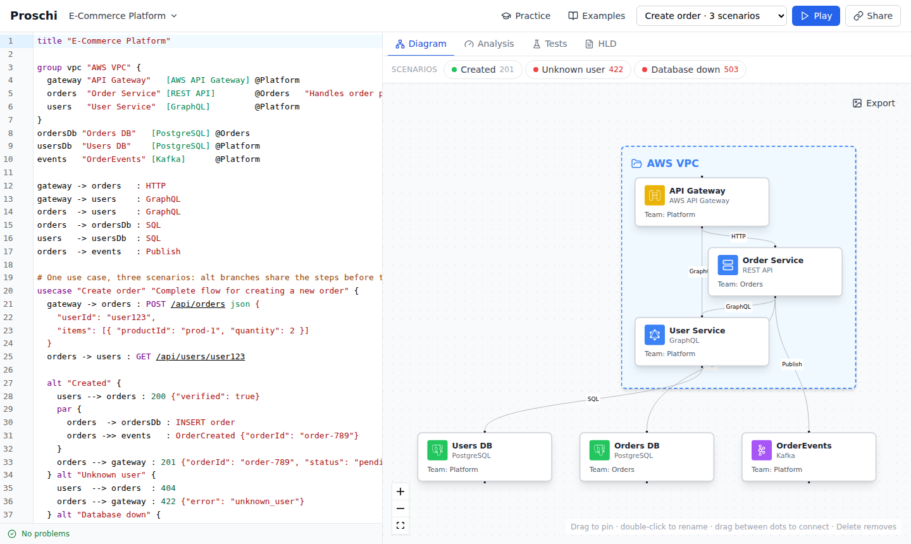

# Proschi for VS Code

Language support for [Proschi](https://proschi.app/), a small text
language for microservice architectures and the request flows that run through
them.



<sub>A document and its diagram in the web editor; the preview in VS Code draws the same diagram.</sub>

- Syntax highlighting for `.proschi` files
- The same errors and warnings as the web editor, as you type
- Completion for keywords, node ids, the 108 tech stacks, `capacity` parts and
  the use case and scenario names in quotes
- [Component types](https://proschi.app/docs/types/): every tech has a
  built-in type with its operations, statuses and headers, and you declare
  your own with `extends`. Completion and hover for types and operations,
  and a warning for an operation the target's type doesn't know:

  ```proschi
  type LedgerDb extends PostgreSQL { op write APPEND }

  api    "Payments API" [REST API]
  ledger "Ledger"       [LedgerDb]

  usecase "Pay" {
    api -> ledger : APPEND entry
  }
  ```
- Rename (*F2*) of node ids, use cases and scenarios, with their references
  in every `.proschi` file of the workspace that imports them
- Quick fixes: add a missing connection or a traffic line, fix a tech stack,
  remove a repeated capacity part, and apply the `x2` or `shards N` a failing
  requirement suggests
- Simulation results in the code: utilisation and monthly cost after each
  node (`62% · $400/mo`), `p99 38 ms ✓` above each use case, and results
  above `whatif` and `requirements` blocks. Turn them off with
  `proschi.inlayHints.enabled` and `proschi.codeLens.enabled`
- Hover, go to definition, find references and an outline of groups, use cases
  and scenarios
- Formatting (*Format Document*), the same layout as `proschi fmt`
- A live preview: *Proschi: Open Preview to the Side* (the preview button in
  the editor title bar) shows the architecture and, for the scenario you pick,
  its sequence diagram. It updates as you type and follows the active
  `.proschi` editor.

The validation runs the parser the web editor uses, so the two never disagree.
See the [language reference](https://github.com/gvart/proschi/blob/main/docs/LANGUAGE.md)
and the [editor and CI guide](https://github.com/gvart/proschi/blob/main/docs/EDITORS.md),
which also covers the `proschi` command line and the GitHub Action.
